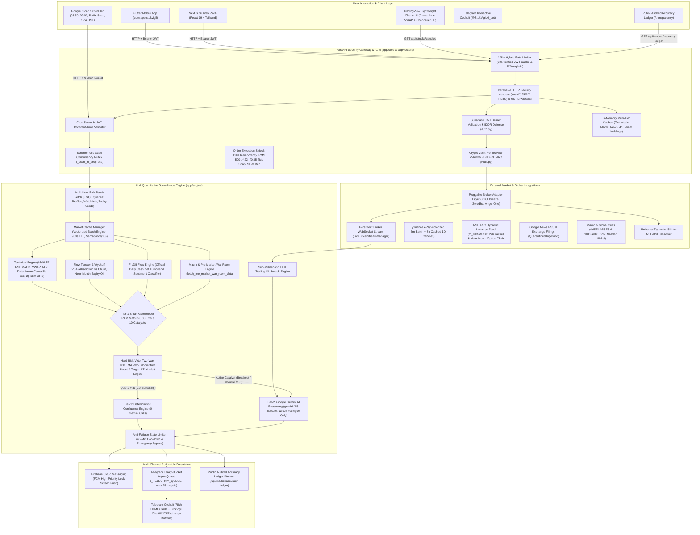
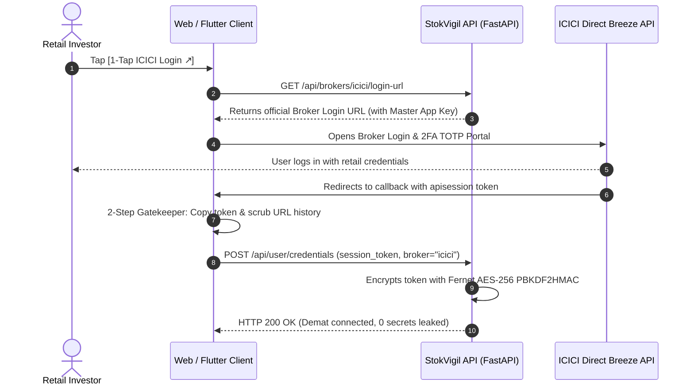

# StokVigil AI (`com.app.stokvigil`)
**Institutional-Grade 5-Minute Market Surveillance & Quantitative Confluence Intelligence Platform**

[](https://www.nseindia.com)
[-10B981?style=flat-square)](https://cloud.google.com/run)
[](https://supabase.com)
[](https://ai.google.dev)
[-brightgreen?style=flat-square)](backend/tests)
[](mobile_app)

---

## 🏛️ Executive Summary & Mission
**StokVigil AI** is an unsleeping, automated 5-minute quantitative surveillance watchtower engineered exclusively for the **National Stock Exchange of India (NSE)** and **Bombay Stock Exchange (BSE)**, combined with automated personal Demat portfolio monitoring (via ICICI Direct Breeze and pluggable broker adapters).

The system operates strictly within **100% Free-Tier Cloud Architecture** (Google Cloud Run request-based compute, Supabase PostgreSQL with PgBouncer transaction connection pooling, Firebase Cloud Messaging, Telegram Bot API, and Gemini 3.5 Flash Lite LLM reasoning).

```
               ┌────────────────────────────────────────────────────────┐
               │         STOKVIGIL MANDATORY LEGAL & TECH INVARIANTS    │
               └──────────────────────────┬─────────────────────────────┘
                                          │
    ┌───────────────────────────┬─────────┴─────────┬───────────────────────────┐
    ▼                           ▼                   ▼                           ▼
[1. Pure Intelligence]   [2. Zero-Default]   [3. Free-Tier 0-Cost]   [4. Bank-Grade Security]
No automated trades;      Never display dummy Always fit in 360k      AES-256 Fernet vault;
SEBI non-advisory         values; null/None   vCPU-s/mo; 3 DB bulk    BOLA/IDOR JWT defense;
mathematical alerts       when real data missing  queries; RAM caches     10K+ hybrid rate limit
```

---

## 🛡️ Non-Negotiable Operational Invariants

### 1. Pure Intelligence & Non-Advisory Guarantee
- **Zero Unsolicited Trades**: StokVigil AI never executes unsolicited automated trades. Trade execution occurs exclusively when the user manually and explicitly confirms an order via the interactive `TradeOrderModal`.
- **SEBI Non-Advisory Compliance**: The system never issues SEBI-unregistered financial tips or speculative advisory price targets (e.g., *"BUY AT ₹200, TARGET ₹250"*). All alerts are strictly structured as objective **Quantitative Confluence Probability Scores (1–100)** with mathematical risk-reward levels.
- **Mathematical Benchmark Terminology**: Projections are strictly labeled as:
  - **Tactical Resistance 1 (1.5x ATR Benchmark)**
  - **Expansion Resistance 2 (2.5x ATR Benchmark)**
  - **Tactical Support 1 / 2**
  - **Protective Stop-Loss**
- **Statutory Footnote**: Every alert notification, Telegram card, and Web/Mobile HUD card concludes with the mandatory statutory compliance notice:
  > *"⚖️ SEBI Non-Advisory Compliance Disclosure: StokVigil AI provides algorithmic quantitative data and mathematical tracking strictly for educational and surveillance purposes. Not investment advice or research recommendations. Trading in securities involves capital risk. Consult a SEBI-registered advisor before executing orders."*

### 2. Strict Zero-Default Policy (Pure Data Integrity Invariant)
- **Core Axiom**: *"Do not display default or placeholder values if we do not receive actual exchange values."*
- **Zero Fabricated Numbers**: Never substitute arbitrary fallback dummy metrics (e.g., `50.0` RSI, `20.0` ADX, `52.0%` delivery, `1.0` PCR, `₹0.00` tactical levels, fake `24500.0` / `80000.0` index prices, `14.5` VIX, fake `+1,270.60 Cr` synthetic FII/DII proxy, or synthetic win rates like `71.2%`).
- **Graceful Null Propagation**: If market feeds fail, prices are $\le 0$, or candle history is insufficient:
  - Backend functions strictly return `None` (JSON `null`) and `"DATA_UNAVAILABLE"`.
  - Client watchlists and quote cards display clean, non-misleading `"--"` indicators.
  - The `[⚡ Trade Order]` execution button is disabled (`pointer-events: none`, opacity `45%`) for unpriced stocks.
  - Telegram alert formatters completely suppress metric lines and tactical sections when values are null.

### 3. 100% Free-Tier Cost Optimization
- **360,000 vCPU-seconds/mo Budget**: Google Cloud Run request-based compute provides 360,000 vCPU-seconds and 2 million requests per month free.
- **Synchronous Execution Guarantee**: The 5-minute surveillance scan runs synchronously during the active HTTP request (`curl -m 480`), ensuring 100% CPU allocation without paying for `--no-cpu-throttling`.
- **Multi-User Bulk Prefetch**: Deduplicates queries across all users into **exactly 3 bulk SQL queries** per scan cycle (`profiles`, `user_watchlists`, `user_credentials WHERE token_date = CURRENT_DATE`), grouping in RAM in $O(N)$ time (<2ms) and reducing database latency from ~45s to <0.2s.
- **In-Memory Caches**: Thread-safe singleton cache (`MarketCacheManager`) stores technical indicators in RAM with 900s (15-min) TTL, delivering sub-0.02ms lookups and slashing third-party network calls by 95%.
- **Decoupled Broker Polling**: Demat broker polling is completely decoupled from surveillance: delivery holdings are read from 4-hour RAM cache (`_DEMAT_PORTFOLIO_CACHE`), generating 0 broker HTTP calls during market scans.

### 4. Zero-Trust Bank-Grade Security
- **BOLA / IDOR Elimination**: Every user-scoped route validates Supabase JWT Bearer tokens matching `auth.uid() = user_id`.
- **Least-Privilege Key Enforcement**: Client APKs and Web bundles strictly use `SUPABASE_ANON_KEY`. CI/CD pipeline aborts if `SUPABASE_SERVICE_ROLE_KEY` is present in client builds.
- **Vault Encryption**: Broker session tokens are encrypted at rest with Fernet AES-256 and PBKDF2HMAC (100,000 iterations, SHA-256). Production enforces a fail-closed zero-trust policy (unencrypted tokens raise fatal errors).
- **10K+ Concurrent User Hybrid Rate Limiting**: Dual-key sliding window distinguishing verified JWT users (`usr:<user_id>`) from anonymous IP clients (`ip:<client_ip>`, 120 req/min) with a 60-second in-memory verified JWT cache (`_VERIFIED_JWT_CACHE`) to eliminate unverified claims spoofing and target-victim DoS.
- **Constant-Time Verification**: `CRON_SECRET_KEY` and `TELEGRAM_WEBHOOK_SECRET` validate via `hmac.compare_digest`.
- **Log Sanitization**: All user IDs, UUIDs, and Telegram Chat IDs are masked in server logs via `mask_id` exposing only the last 4 characters (`***XXXX`), and Telegram bot tokens in URLs or logs are stripped via `mask_telegram_token`.

---

## 🏗️ End-to-End System Architecture



---

## 🧠 The 2-Tier Quantitative AI Surveillance Engine

### The Dynamic Confluence Formula
$$\text{Confluence Score} = (W_{\text{tech}} \times \text{Technical}) + (W_{\text{flow}} \times \text{Flow}) + (W_{\text{forensics}} \times \text{Forensics}) + (W_{\text{news}} \times \text{News})$$

#### Dynamic Adaptive Weights Matrix:
| Market Regime | Real-Time Conditions | Tech ($W_{\text{tech}}$) | Flow ($W_{\text{flow}}$) | Forensics ($W_{\text{forensics}}$) | News ($W_{\text{news}}$) | Tactical Rationale |
| :--- | :--- | :---: | :---: | :---: | :---: | :--- |
| **High Volatility / Distribution** | $\text{India VIX} > 16.5$ OR $\text{ADR} < 0.80$ OR missing data | **15%** | **35%** | **35%** | **15%** | **Defensive Posture**: Prioritizes balance sheet safety and institutional delivery absorption to prevent bull-trap drawdowns. |
| **Bull Momentum Trend** | $\text{India VIX} \le 14.5$ AND $\text{ADR} \ge 1.20$ | **40%** | **30%** | **15%** | **15%** | **Trend Following**: Maximizes capture of momentum breakouts and opening range expansions. |
| **Balanced / Normal Market** | Default / Neutral conditions | **30%** | **25%** | **25%** | **20%** | **Balanced Surveillance**: Standard multi-factor confluence. |

---

### Tier-1 Smart Gatekeeper (`check_has_active_catalyst`)
Real institutional desks do not burn neural network inference on quiet or sideways stocks. Before invoking Google Gemini AI, StokVigil evaluates 10 quantitative criteria in RAM (<0.001 ms):
1. **Demat Stop-Loss / Target Risk**: Position down $\le -3.5\%$ (capital defense) OR position up $\ge +5.0\%$ with $15\text{m RSI} > 70.0$.
2. **Sharp Price Surge / Breakdown**: Intraday move magnitude $|\Delta P| \ge 2.5\%$.
3. **15-Minute Opening Range Breakout (ORB)**: `BULLISH_ORB_BREAKOUT` or `BEARISH_ORB_BREAKDOWN` with confirmed candle close (`candle_close_confirmed`).
4. **Circuit Lock Freezes**: Upper or lower circuit freeze (`UPPER_CIRCUIT` or `LOWER_CIRCUIT`, $|H-L| < 10^{-4}$ and $|\Delta P| \ge 1.9\%$).
5. **Institutional Volume Surge**: Intraday volume $\ge 1.5\times$ 20-period volume MA.
6. **Momentum Extremes / Divergence**: $15\text{m RSI} \ge 68.0$ or $\le 32.0$, or active Bullish/Bearish Divergence.
7. **MACD Trend Transition**: 15m MACD Bullish Crossover.
8. **Institutional Flow & F&O Build-up**: Delivery $\ge 50\%$, or active F&O Open Interest buildup with PCR $\ge 1.3$ or $\le 0.7$, or extreme Option Chain PCR ($\ge 1.4$ or $\le 0.6$).
9. **Intraday VWAP Breakout**: Price deviating $\ge 1.2\%$ from VWAP, or $\ge 0.8\%$ with volume surge.
10. **Corporate Filings / News Catalysts**: Real-time contract wins, quarterly earnings, debt shifts, or block deals.

- **Consolidating Stocks**: Evaluated deterministically in RAM consuming **0 Gemini API calls**.
- **Active Catalyst Stocks**: Handed off to **Tier-2 (Google Gemini AI)** for qualitative synthesis, capped by `MAX_AI_CALLS_PER_SCAN = 15` per 5-minute cycle to permanently eliminate `429 Quota Exceeded` errors.

---

## 🏛️ The 18 Institutional Quantitative Pillars

| # | Quantitative Pillar | Rule & Implementation Reality |
| :-: | :--- | :--- |
| **1** | **Hard Risk Veto (Supply Shock)** | If intraday price drops $\le -3.5\%$, OR falls below intraday VWAP with volume surge, OR breaches Camarilla $L_4$ $\rightarrow$ Confluence score is hard-capped at $\le 28$, `action_bias` is forced to `SELL_WATCH`, overriding fundamental buoys. |
| **2** | **Demat Capital Preservation Shield** | For portfolio holdings, if position unrealized loss reaches $\le -3.5\%$, an automatic emergency `TRAILING_SL_ALERT` is triggered immediately regardless of baseline score. |
| **3** | **Positive Momentum Surge Boost** | When $\Delta P \ge +5.0\%$ with a confirmed `BULLISH_ORB_BREAKOUT`, inject **+6 point momentum surge boost**, categorizing it as `PRICE_BREAKOUT`. |
| **4** | **15-Minute ORB Engine** | Quantifies 09:15–09:30 IST opening corridor into `orb_high_15m` and `orb_low_15m`. Evaluates `BULLISH_ORB_BREAKOUT`, `BEARISH_ORB_BREAKDOWN`, or `INSIDE_ORB_RANGE`. |
| **5** | **Date-Aware Camarilla Pivots** | Computes $H_4, H_3, L_3, L_4$. When evaluating live market sessions, strictly calculate from `iloc[-2]` (prior completed trading day), never from the forming intraday bar at `iloc[-1]`. |
| **6** | **Circuit Lock Freeze Detection** | Detects $H=L=C$ within $10^{-4}$ tolerance with $|\Delta P| \ge 1.9\%$, classifying stocks into `UPPER_CIRCUIT` (score $\ge 85$) or `LOWER_CIRCUIT` (score $\le 15$). |
| **7** | **Near-Month Options Expiry Filter** | Restricts NSE option chain analytics strictly to the nearest active expiry date (`records["expiryDates"][0]`), eliminating illiquid far-month contracts from distorting PCR and Max Pain. |
| **8** | **Universal Sensitivity Gate** | Ensures users on `ALL` sensitivity reliably receive all valid actionable alerts, breakdowns, and capital defense triggers. |
| **9** | **Two-Way 200 EMA Macro Trend Anchor** | Long setups (`BUY_WATCH`) below Daily 200 EMA are vetoed to `HOLD_NEUTRAL`; Short setups (`SELL_WATCH`) above 200 EMA are vetoed to `HOLD_NEUTRAL` (unless severe supply shock triggers emergency exit). |
| **10** | **15m Candle Close & Wick Rejection** | Breakouts are evaluated strictly at 15m candle close boundaries (`is_15m_candle_closed` & `candle_close_confirmed`), filtering out false intra-bar breakout traps (`ORB_UPPER_WICK_REJECTION`). |
| **11** | **Target 1 Trail-to-Cost Alert** | When an active position or watchlist ticker crosses Tactical Resistance 1 (1.5x ATR), triggers `TARGET_1_TRAIL_ALERT`: *"🎯 TARGET 1 REACHED: Lock 50% Gains & Trail Stop-Loss to Breakeven Cost"*. |
| **12** | **SEBI Non-Advisory Terminology** | Eliminates advisory tip phrasing. Strictly labels levels as "Tactical Resistance 1 (1.5x ATR Benchmark)" and "Expansion Resistance 2 (2.5x ATR Benchmark)" with statutory disclaimers. |
| **13** | **SL-L Routing & SL-M Ban** | Full compliance with SEBI circulars banning Stop-Loss Market (`SL-M`) orders. Market-stop orders are rejected (`HTTP 422`); orders route strictly as `SL-L` snapped to ₹0.05 exchange ticks. |
| **14** | **Dynamic Sector Universe & BSE Resolver** | Dynamically queries official NSE sector constituent lists (250+ equities, 0 hardcoded stock lists) daily with 24h cache. BSE 6-digit numeric codes and `.BO` suffixes resolve via BSE India's official API on-the-fly. |
| **15** | **1% Capital Risk Position Sizer** | Mathematical risk sizing: $\text{Risk Budget} = \max(₹500, \text{Portfolio} \times 0.01)$; $\text{Qty} = \lfloor \text{Risk Budget} / |\text{Price} - \text{SL}| \rfloor$. Dispatches sizing guidance on Telegram alerts and HUD cards. |
| **16** | **Vectorized Strategy Backtester** | In-memory historical strategy simulation powered by NumPy/Pandas (<1s execution) exposed via authenticated endpoints `GET /api/market/backtest` and `POST /api/market/backtest`. |
| **17** | **15:45 Closing Bell Executive Digest** | Automated post-market closing scorecard dispatched at 03:45 PM IST summarizing NIFTY 50, SENSEX, India VIX, Market Breadth ADR, FII/DII cash turnover, sector leaders/laggards, and algorithmic Target 1 hit rates. |
| **18** | **Public Audited Accuracy Ledger** | Real subsequent OHLCV price tracking (`app/accuracy_verifier.py`) verifying genuine historical hit rates (`TARGET_1_REACHED`, `STOP_LOSS_HIT`, `OPEN_MONITORING`) at `/transparency` with zero mock data and zero PII. |

---

## 🔑 Pluggable Multi-Broker Architecture (Strategy Pattern)

StokVigil AI implements the **Pure Master App Publisher Model**:
- Retail users **never register custom developer apps**, never handle API keys, and never manage secret keys.
- StokVigil server securely maintains verified Master App publisher credentials (`ICICI_MASTER_APP_KEY`, `ICICI_MASTER_SECRET_KEY`).



### Financial Trade Execution Safeguards (`POST /api/v1/orders/place`)
1. **Idempotency Replay Shield (`_ORDER_IDEMPOTENCY_CACHE`)**: Tracks SHA-256 fingerprint hashes `(user_id, symbol, action, quantity, price)` with 120s TTL and 15s auto-debounce. Concurrent duplicate requests receive `HTTP 409 Conflict`. Replays return identical responses (`idempotent_replay: true`) without re-hitting the broker.
2. **Silent RMS Rejection Interception**: Breeze API returns HTTP 200 with `{"Status": 500, "Error": "RMS: Margin Shortage..."}`. The backend intercepts this and raises `HTTP 422 Unprocessable Entity` with the exact broker error.
3. **Exchange ₹0.05 Tick Snapping (`snap_to_exchange_tick`)**: Snaps limit and stop-loss prices to standard ₹0.05 tick intervals using financial half-up rounding (`round(price * 20) / 20`).
4. **SEBI/NSE `SL-M` Ban Enforcement**: Stop-Loss Market orders are rejected with `HTTP 422`. Only Stop-Loss Limit (`SL-L`) orders with explicit `price` and `trigger_price` are permitted.
5. **Dynamic Product Resolution & SEBI MIS Notice**: Sells of held Demat shares route as `cash` (CNC). Sells of unheld shares route as `margin` (MIS short) and inject mandatory SEBI intraday margin short warnings.
6. **Market Session Awareness**: Orders placed outside 09:15–15:30 IST return `"session_warning": "Market is currently closed. Order will be processed as AMO or queued by broker."`.
7. **Automated BSE Order Routing**: Strips `.BO` suffixes, maps 6-digit scrips, and routes `exchange_code="BSE"` vs `"NSE"`.

---

## 🗄️ Database Architecture & PgBouncer Multiplexing

### Supabase PgBouncer Pool (Port 6543)
- Built on `asyncpg` connected to port 6543 in **Transaction Pooling Mode**.
- Required pool settings:
  ```python
  statement_cache_size = 0  # CRITICAL: Prevents prepared statement collisions in transaction pooling
  command_timeout = 10.0
  max_inactive_connection_lifetime = 180.0
  min_size = 2
  max_size = 10
  ```
- **Parameter Normalization (`_normalize_param`)**:
  - UUID strings converted to Python `uuid.UUID` objects for B-tree index compatibility.
  - Date strings (`YYYY-MM-DD`) converted to Python `datetime.date` objects so `asyncpg` wire protocol codecs serialize them via `.toordinal()` (eliminating `DataError: 'str' object has no attribute 'toordinal'`).
- **Dual-Driver Zero-Downtime Fallback**: If PgBouncer connection fails or `DATABASE_URL` is unconfigured, all operations seamlessly fall back to `supabase.Client` REST API.

### Database Tables & Schema Contract
1. **`profiles`**: User identity, notification preferences (`fcm_device_token`, `fcm_enabled`, `telegram_chat_id`, `telegram_enabled`), alert sensitivity (`HIGH`, `ALL`, `FII`), execution mode (`INSTANT`, `CONFIRM`), demat auto-sync.
2. **`user_credentials`**: Encrypted broker session tokens (`encrypted_session_token`), broker identifier (`icici`), token date (`token_date`), RLS policy `auth.uid() = user_id`.
3. **`user_watchlists`**: Persists Demat cost basis (`average_buy_price`, `quantity`, `last_synced_at`) via migration `20261004_persist_demat_cost_basis.sql` with composite index `idx_watchlists_user_auto_sync (user_id, is_auto_synced)`.
4. **`stok_alerts`**: Persistent record of evaluated catalysts, direction-aware tactical levels, confluence scores, metrics snapshot, and dispatch channels.
5. **`fii_dii_flows`**: Persistent store of official daily NSE FII/DII net purchases, sales, combined net flows, and institutional sentiment bias.

---

## ⚡ Multi-Channel Dispatch & Notification Cockpit

### 1. Telegram Interactive Cockpit (`@StokVigilAi_bot`)
- **Anti-Hijacking Security**: Pairing strictly requires internal User UUID (`/start <USER_ID>`). Pairing via email is rejected (`reason: email_not_permitted`). Webhook authenticity validated via `X-Telegram-Bot-Api-Secret-Token`.
- **Leaky-Bucket Queue (`_TELEGRAM_QUEUE`)**: Alert dispatches are enqueued into an in-memory `asyncio.Queue` and processed by a background worker capped at **25 messages/second** (40ms interval) with exponential `HTTP 429 Retry-After` backoff.
- **Card Elements**:
  - Color-coded action badges (`🟢 ACCUMULATE / BUY WATCH`, `🔴 PROFIT BOOK / SELL WATCH`, `🟡 TRAILING SL ALERT`, `🎯 TARGET 1 REACHED: TRAIL TO COST`).
  - Wyckoff VSA market snapshot: LTP, Day Change %, 15m ORB status, Delivery %, 15m RSI, VWAP, F&O OI status.
  - Tactical Risk-Reward Levels (Entry, Tactical Resistance 1, Expansion Resistance 2, Tactical Support 1/2, Stop-Loss, R:R).
  - 1% Capital Risk Position Sizing (`recommended_quantity`, `capital_at_risk`, `risk_budget`).
  - Interactive Action Buttons:
    - `[📊 StokVigil Chart]`: Deep link directly opening the live chart in StokVigil Web PWA (`${WEB_PORTAL_URL}/chart?symbol={SYMBOL}&exchange={EXCH}`) with TradingView fallback.
    - `[💼 ICICI Direct]`: Deep link to portfolio execution.
    - `[🏛️ NSE / BSE Live]`: Direct link to official exchange filings (native support for 6-digit BSE scrips).
  - Mandatory SEBI non-advisory compliance disclosure footer.

### 2. Firebase Cloud Messaging (FCM Push)
- Dedicated high-priority notification channel: `stokvigil_high_priority_alerts`.
- Includes payload metadata (`symbol`, `action_bias`, `confluence_score`, `catalyst_type`) for deep link routing.

---

## 💻 Frontend Client Specifications (Web & Mobile)

### Design System & Theme Tokens
- **Dark Terminal Theme**:
  - Primary Background: `#090D16` / `#0D1117`
  - Card Background: `#131B2E` / `#161F36`
  - Surface Border: `#1E293B`
  - Accent Neon: Cyan `#00B4D8`, Indigo `#6366F1`, Violet `#8B5CF6`
  - Bullish: Emerald `#10B981`, Bearish: Rose `#EF4444`, Warning: Amber `#F59E0B`
- **Brand Neon Action Button**: Permanently rendered with 4-color brand gradient (`#00B4D8` $\rightarrow$ `#0284C7` $\rightarrow$ `#6366F1` $\rightarrow$ `#8B5CF6`) and cyan neon glow.
- **Privacy Masking**: Demat portfolio values (Total Value, Returns, P&L, Invested) are masked by default (`₹ • • • • • •`) with an interactive `👁️ Show / Hide` toggle.
- **Pulsing Market Indicator**: Synchronized animated pulsing dot: `NSE/BSE LIVE 09:15–15:30`.
- **4-Column High-Density Metric Strip**: Standardized across Mobile and Web (`DELIVERY`, `RSI (15M)`, `VWAP`, `F&O / OI`).

### TradingView Lightweight Charts v5
- Integrated across Next.js Web (`LightweightCandleChart.tsx`) and Flutter Mobile (`CandleChartScreen` & `CandleChartModal`).
- Native suppression of third-party branding (`attributionLogo: false`).
- Embedded subtle canvas-rendered **StokVigil 'SV' watermark** and Pro Terminal badge.
- Interactive overlays: Camarilla Pivots ($H_4, H_3, L_3, L_4$), Cumulative VWAP, Chandelier Trailing Stop, and Volume Histogram.
- Offline preloaded JavaScript assets on mobile (`assets/js/lightweight-charts.standalone.production.js`), eliminating WebView white-screen hanging.

### 4-Pillar Confluence Radar Chart & 1-Tap Alpha Cards
- **Radar Chart**: Visualizes Technical (30%), Wyckoff Flow (25%), Forensic Health (25%), and Macro/News (20%) via SVG polygon (Web) and Flutter `CustomPainter` (Mobile).
- **1-Tap Alpha Cards**: Client-side off-screen HTML5 2D Canvas generates 1080×1080 high-contrast branded PNG cards with 0 server load, shareable directly to WhatsApp and X.

---

## ⏰ Automated Indian Market Cron Workflows & Cloud Scheduler Architecture

StokVigil AI is orchestrated primarily via **Google Cloud Scheduler** (with exact `Asia/Kolkata` timezones and 480-second execution deadlines) with secondary fallback via **GitHub Actions**.

### Google Cloud Scheduler Configuration (Primary)
- **Timezone**: `Asia/Kolkata` (`IST`)
- **Attempt Deadline**: **`480s`** (8 minutes) — guarantees scans complete without Google Cloud dropping the HTTP connection.
- **Headers**:
  - `Content-Type: application/json`
  - `X-Cron-Secret: <CRON_SECRET_KEY>` (Verified via constant-time HMAC `hmac.compare_digest`)

| Job Name | Schedule (IST) | Trigger Endpoint | Execution Logic |
| :--- | :--- | :--- | :--- |
| `stokvigil-token-reminder` | `50 8 * * 1-5` (08:50 AM) | `POST /api/cron/morning-token-reminder` | Checks expired session tokens; pushes FCM & Telegram reminders 25 min prior to open. Pre-syncs active Demat holdings into 4-hour RAM cache (`_DEMAT_PORTFOLIO_CACHE`) and updates persistent `average_buy_price` in `user_watchlists`. |
| `stokvigil-pre-market-war-room` | `0 9 * * 1-5` (09:00 AM) | `POST /api/cron/pre-market-briefing` | Dispatched 15 min before open. Aggregates GIFT Nifty, US/Asian markets, India VIX regime, FII/DII net flows, and sector momentum. Triggers 30-day historical alert pruning via `app.maintenance.prune_historical_alerts`. |
| `stokvigil-5min-surveillance` | `*/5 9-15 * * 1-5` (09:15–15:30) | `POST /api/cron/multi-user-scan` | Executes synchronously during HTTP request (`curl -m 480`) to guarantee 100% CPU on Cloud Run Free Tier. 3 bulk DB queries, vectorized batch 5m downloads, 2-Tier Gatekeeper, parallel symbol evaluation with `asyncio.gather`. Guarded by `_scan_in_progress` mutex. |
| `stokvigil-closing-bell` | `45 15 * * 1-5` (03:45 PM) | `POST /api/cron/post-market-summary` | Dispatched 15 min after close. Scorecard of NIFTY 50, SENSEX, India VIX, Market Breadth ADR, FII/DII net flows, sector rotation leaders/laggards, and day's algorithmic Target 1 hit rate. |

---

## 📈 Quantitative Engine & Risk Defense Invariants

StokVigil AI's deterministic engine enforces strict mathematical guardrails to eliminate emotional retail trading mistakes:
1. **Demat Capital Defense Shield & Zero-Token Fallback**: Automatically triggers `CAPITAL_PRESERVATION_EXIT` when a holding's unrealized loss reaches $\le -3.5\%$. Even if daily broker tokens expire overnight, persistent cost-basis fields (`average_buy_price`, `quantity`) cached in `user_watchlists` are loaded to guarantee stop-loss surveillance without manual re-login.
2. **Macro Market Crash & Volatility Regime Trigger**: Calibrated `evaluate_and_dispatch_macro_risk_alert` dispatches emergency risk alerts when NIFTY 50 drops $\le -0.75\%$, or India VIX reaches $\ge 14.5$ with $\text{ADR} < 0.75$, or severe breadth distribution occurs ($\text{ADR} < 0.55$, $>65\%$ declining stocks).
3. **Multi-Day Rolling Drawdown Veto**: Flags multi-session market liquidations when 3-day drop reaches $R_{3D} \le -3.0\%$ below the 20 EMA, or 5-day drop reaches $R_{5D} \le -4.5\%$, forcing `SELL_WATCH` and preventing premature dip-buying.
4. **200 EMA Supply Shock Override**: While the engine normally prevents shorting stocks above their 200 EMA, during broad market distribution ($\text{ADR} < 0.80$, elevated VIX, or Nifty $\le -0.50\%$), the long-trend veto is automatically overridden to preserve breakdown warnings (`SELL_WATCH`, `INTRADAY_MIS_SHORT`).
5. **Macro Gatekeeper Long Veto**: Automatically vetoes `BUY_WATCH` setups to `HOLD_NEUTRAL` during market-wide drops ($\text{ADR} < 0.60$ or elevated VIX), eliminating bull-trap breakout entries.
6. **Wyckoff Microstructure Block Dump & Supply Shock Engine**: Eliminates slow news RSS dependency. Detects real-time institutional liquidation directly from 5-minute tick volume ($RVOL_{20} \ge 2.2\times$), VWAP breakdown ($\Delta P_{\text{VWAP}} \le -0.80\%$), and Close Location Quartile ($\text{CLQ} \le 0.35$), while rejecting false-alarm absorption springs. Triggers instant `CAPITAL_PRESERVATION_EXIT` (Demat) or `INTRADAY_MIS_SHORT` (Watchlist).
7. **RFC 8259 Standard Safe Float Serialization (`SafeJSONResponse`)**: Converts `NaN`, `+Infinity`, and `-Infinity` into standard JSON `null`, completely preventing `ValueError: Out of range float values are not JSON compliant` and HTTP 500 errors across all API routes while strictly upholding the Zero-Default Policy.

---

## 📁 Repository Directory Structure

```
stokvigil-ai/
├── STOKVIGIL_MASTER_PROMPT.md        <-- Canonical Master System Prompt & Technical Standard
├── architecture_blueprint.md         <-- Exhaustive Architectural Specification & Schemas
├── README.md                         <-- Project Documentation & Getting Started Guide
├── .env.example                      <-- Template Environment Configuration
├── backend/
│   ├── Dockerfile                    <-- Container definition for Google Cloud Run
│   ├── requirements.txt              <-- Python 3.11 dependencies
│   ├── app/
│   │   ├── main.py                   <-- FastAPI Application Orchestrator (<140 lines)
│   │   ├── config.py                 <-- Pydantic V2 Settings & Broker Key Sanitation
│   │   ├── vault.py                  <-- AES-256 Fernet Crypto Vault with PBKDF2HMAC
│   │   ├── auth.py                   <-- Supabase JWT Bearer Auth & PII Masking
│   │   ├── db_pool.py                <-- Supabase PgBouncer (Port 6543) Pool Manager
│   │   ├── technical_engine.py       <-- Multi-TF Indicators, Date-Aware Camarilla, 15m ORB
│   │   ├── flow_tracker.py           <-- Dynamic NSE F&O Universe, Wyckoff VSA & Delta OI
│   │   ├── fii_dii_tracker.py        <-- Official Daily Cash Net Turnover & Sentiment
│   │   ├── macro_filter.py           <-- Market Breadth ADR, VIX Regimes, Sector Alpha
│   │   ├── notifications.py          <-- FCM Push & Telegram Leaky-Bucket Queue (25 msgs/s)
│   │   ├── alert_limiter.py          <-- 45-Min Cooldown Machine with Emergency Bypass
│   │   ├── accuracy_verifier.py      <-- Audited Real Price-Tracking Verification Engine
│   │   ├── backtester.py             <-- Vectorized In-Memory Strategy Backtester
│   │   ├── market_cache.py           <-- Singleton In-Memory Cache (900s TTL, Semaphore(20))
│   │   ├── core/
│   │   │   ├── rate_limiter.py       <-- 10K+ Hybrid Rate Limiter with 60s Verified JWT Cache
│   │   │   └── dependencies.py       <-- Market Session Status & DB Dependencies
│   │   ├── engine/
│   │   │   ├── deterministic.py      <-- Tier-1 Confluence Engine & 10 Gatekeeper Catalysts
│   │   │   ├── gemini_ai.py          <-- Tier-2 Gemini AI Catalyst Reasoning & Injection Isolation
│   │   │   ├── portfolio_sync.py     <-- 3 SQL Bulk Queries Deduplication & Demat Normalization
│   │   │   └── ticker_stream.py      <-- Live Broker WebSocket Ticker Stream Manager
│   │   ├── brokers/
│   │   │   ├── base.py               <-- BaseBrokerAdapter Strategy Contract
│   │   │   ├── icici_adapter.py      <-- ICICI Direct Breeze Broker Implementation
│   │   │   └── registry.py           <-- BrokerRegistry Catalog
│   │   ├── routers/
│   │   │   ├── auth.py               <-- User Profile, Device Registration, Credentials Vault
│   │   │   ├── stocks.py             <-- Ticker Search, Validation, Quotes, Candles
│   │   │   ├── orders.py             <-- Breeze Order Execution, Idempotency Shield, Tick Snapping
│   │   │   ├── market.py             <-- FII/DII Flows, Accuracy Ledger, Backtester
│   │   │   └── cron.py               <-- Surveillance Scanner, Token Reminder, Pre/Post Briefings
│   │   └── schemas/                  <-- Pydantic V2 Data Models
│   └── tests/                        <-- 16-Suite Test Framework (169 Tests Passing)
├── mobile_app/                       <-- Flutter 3 Client (Android / iOS)
│   ├── lib/
│   │   ├── main.dart                 <-- App Entrypoint, Deep Links & Lifecycle Observers
│   │   ├── screens/                  <-- Dashboard, Alerts, Watchlist, Charts, Backtest, Ledger
│   │   ├── services/                 <-- ApiService, FcmService, SupabaseService
│   │   └── widgets/                  <-- Custom HUDs, Confluence Radar, Broker Icons
│   └── assets/js/                    <-- Preloaded Offline Lightweight Charts Bundle
├── web_portal/                       <-- Next.js 16 PWA (React 19 + TypeScript + Tailwind)
│   ├── src/app/                      <-- Dashboard, Transparency Ledger, Callbacks, Proxies
│   └── src/components/               <-- TradingView Charts, Radar, Alpha Cards, TradeOrderModal
└── supabase/
    └── migrations/                   <-- SQL Migrations (RLS, PgBouncer, Demat Cost Basis)
```

---

## 🚀 Step-by-Step Setup & Deployment Guide

### 1. Database Setup (Supabase PostgreSQL)
1. In your [Supabase Dashboard](https://supabase.com), open the SQL Editor and execute migrations in order:
   - `supabase/migrations/20260809_init_stokvigil.sql`
   - `supabase/migrations/20260822_enhance_stokalerts.sql`
   - `supabase/migrations/20260906_fii_dii_flows.sql`
   - `supabase/migrations/20260911_prune_old_alerts_cron.sql`
   - `supabase/migrations/20260919_drop_not_null_broker_keys.sql`
   - `supabase/migrations/20260920_fii_dii_service_role_policy.sql`
   - `supabase/migrations/20260927_add_broker_id_to_user_credentials.sql`
   - `supabase/migrations/20261004_persist_demat_cost_basis.sql`
2. Obtain your `SUPABASE_URL`, `SUPABASE_ANON_KEY`, and `DATABASE_URL` (Port 6543 connection string with `?pgbouncer=true`).

### 2. Backend Setup & Automated Test Verification
1. Navigate to `backend/` and install dependencies:
   ```bash
   cd backend
   python -m venv .venv
   .\.venv\Scripts\pip.exe install -r requirements.txt
   ```
2. Configure environment variables in `backend/.env` (see `.env.example`).
3. Run the automated test suite (verifying all 170 tests pass):
   ```bash
   $env:PYTHONPATH="backend"; $env:ENVIRONMENT="test"; $env:ENCRYPTION_KEY="MDEyMzQ1Njc4OWFiY2RlZjAxMjM0NTY3ODlhYmNkZWY="; backend\.venv\Scripts\python.exe -m unittest discover -s backend/tests -p "test_*.py"
   ```
4. Start the development server:
   ```bash
   .\.venv\Scripts\uvicorn app.main:app --host 0.0.0.0 --port 8000 --reload
   ```

### 3. Telegram Bot Setup
1. In Telegram, open `@BotFather`, create your bot, and obtain your bot token.
2. Register the webhook with secret token validation:
   ```bash
   curl -X POST "https://api.telegram.org/bot<YOUR_TELEGRAM_BOT_TOKEN>/setWebhook" \
        -H "Content-Type: application/json" \
        -d '{"url": "<YOUR_BACKEND_URL>/api/telegram/webhook", "secret_token": "<YOUR_TELEGRAM_WEBHOOK_SECRET>"}'
   ```

### 4. Running the Web Portal (Next.js 16 PWA)
```bash
cd web_portal
npm install
npm run dev
```
Access the application at `http://localhost:3000` and the public transparency ledger at `http://localhost:3000/transparency`.

### 5. Running the Flutter Mobile App (`com.app.stokvigil`)
```bash
cd mobile_app
flutter run --dart-define=SUPABASE_URL="https://your-project.supabase.co" --dart-define=SUPABASE_ANON_KEY="your-anon-key" --dart-define=BACKEND_URL="https://your-backend.run.app"
```

---

## ⚖️ Regulatory Compliance & Disclaimer
**SEBI Non-Advisory Compliance Disclosure**: StokVigil AI provides algorithmic quantitative data and mathematical tracking strictly for educational and surveillance purposes. Not investment advice or research recommendations. Trading in securities involves capital risk. Consult a SEBI-registered financial advisor before executing orders.
