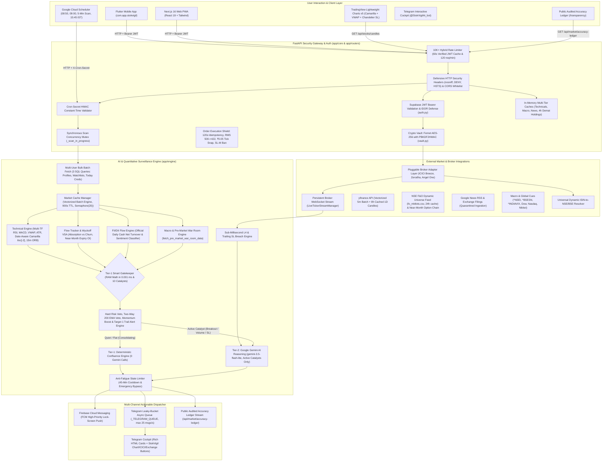
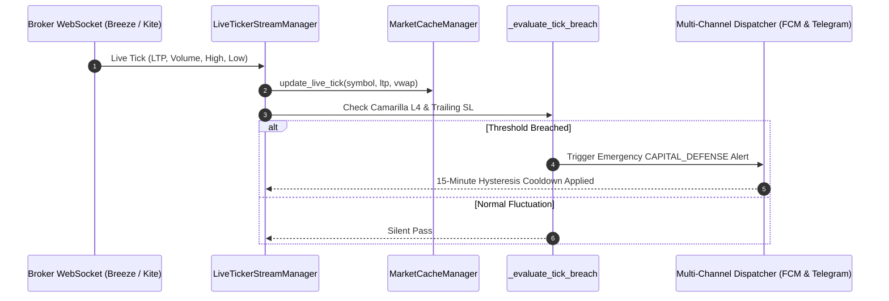
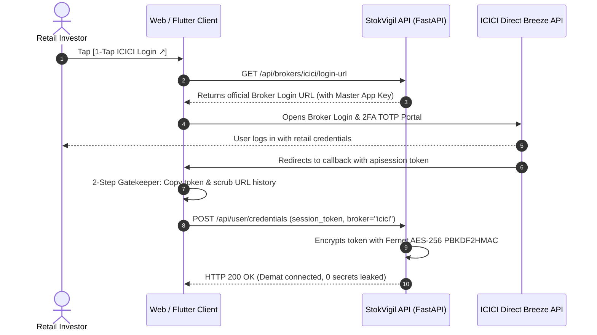

# StokVigil AI — System Architecture Blueprint & Design Specification
**Package Identifier:** `com.app.stokvigil`  
**Deployment Infrastructure:** Google Cloud Run (Free Tier) + Supabase PostgreSQL (Port 6543 PgBouncer) + Firebase FCM + Telegram Bot API  
**Client Frontends:** Flutter 3 (Android / iOS) & Next.js 16 PWA (React 19 + TypeScript + Tailwind CSS)  
**Operating Regime:** Strictly Indian Stock Exchange Trading Hours (09:15 AM – 03:30 PM IST, Monday through Friday)  
**Document Classification:** Permanent System Architecture Blueprint & Engineering Reference

---

## 📑 Table of Contents
1. [System Identity, Core Purpose & Operational Invariants](#1-system-identity-core-purpose--operational-invariants)
2. [End-to-End System Data Flow & Security Architecture](#2-end-to-end-system-data-flow--security-architecture)
3. [The 2-Tier Quantitative AI Surveillance Engine](#3-the-2-tier-quantitative-ai-surveillance-engine)
   - [3.1 Dynamic Confluence Formula & Regime-Adaptive Factor Weights](#31-dynamic-confluence-formula--regime-adaptive-factor-weights)
   - [3.2 Tier-1 Quantitative Smart Gatekeeper (RAM Math in 0.001 ms)](#32-tier-1-quantitative-smart-gatekeeper-ram-math-in-0001-ms)
   - [3.3 Tier-2 Google Gemini AI Engine](#33-tier-2-google-gemini-ai-engine)
   - [3.4 The 18 Critical Quantitative Upgrades & Execution Realities](#34-the-18-critical-quantitative-upgrades--execution-realities)
   - [3.5 Wyckoff Volume-Spread Analysis (VSA) & Dynamic Options Flow](#35-wyckoff-volume-spread-analysis-vsa--dynamic-options-flow)
   - [3.6 Direction-Aware Tactical Levels Formulation](#36-direction-aware-tactical-levels-formulation)
4. [Persistent Real-Time Broker WebSocket Streaming Engine](#4-persistent-real-time-broker-websocket-streaming-engine)
5. [Pluggable Multi-Broker Architecture (Strategy Pattern)](#5-pluggable-multi-broker-architecture-strategy-pattern)
   - [5.1 Pure Master App Publisher Model](#51-pure-master-app-publisher-model)
   - [5.2 Financial Trade Execution Safeguards & Idempotency Shield](#52-financial-trade-execution-safeguards--idempotency-shield)
6. [Database & Connection Pooling Architecture (Supabase PgBouncer)](#6-database--connection-pooling-architecture-supabase-pgbouncer)
   - [6.1 PgBouncer Multiplexing & Binary Parameter Normalization](#61-pgbouncer-multiplexing--binary-parameter-normalization)
   - [6.2 Database Schema Contract & Demat Cost Basis Persistence](#62-database-schema-contract--demat-cost-basis-persistence)
7. [Multi-Channel Dispatch & Notification Cockpit](#7-multi-channel-dispatch--notification-cockpit)
   - [7.1 Telegram Interactive Cockpit & Leaky-Bucket Queue](#71-telegram-interactive-cockpit--leaky-bucket-queue)
   - [7.2 Firebase Cloud Messaging (FCM High-Priority Push)](#72-firebase-cloud-messaging-fcm-high-priority-push)
   - [7.3 Anti-Fatigue State Limiter & Emergency Bypass](#73-anti-fatigue-state-limiter--emergency-bypass)
8. [Vectorized Strategy Backtester & Public Audited Accuracy Ledger](#8-vectorized-strategy-backtester--public-audited-accuracy-ledger)
9. [Frontend Client Specifications (Mobile & Web)](#9-frontend-client-specifications-mobile--web)
   - [9.1 Design System & Theme Tokens](#91-design-system--theme-tokens)
   - [9.2 TradingView Lightweight Charts v5 Integration](#92-tradingview-lightweight-charts-v5-integration)
   - [9.3 4-Pillar Confluence Radar Chart & 1-Tap Alpha Cards](#93-4-pillar-confluence-radar-chart--1-tap-alpha-cards)
10. [Automated Indian Market Cron Workflows](#10-automated-indian-market-cron-workflows)
11. [Enterprise Security Controls & Vulnerability Defenses](#11-enterprise-security-controls--vulnerability-defenses)
12. [Testing Framework & Verification Metrics](#12-testing-framework--verification-metrics)

---

## 1. System Identity, Core Purpose & Operational Invariants

### 1.1 System Identity & Mission
**StokVigil AI** (`com.app.stokvigil`) is an unsleeping, automated 5-minute market surveillance watchtower and quantitative intelligence platform engineered exclusively for Indian Stock Exchanges (**NSE** and **BSE**) and personal Demat portfolio monitoring (via ICICI Direct Breeze and multi-broker adapters).

The platform operates strictly within **100% Free-Tier Cloud Architecture** (Google Cloud Run request-based compute, Supabase PostgreSQL with PgBouncer connection pooling, Firebase Cloud Messaging, Telegram Bot API, and Gemini 3.5 Flash Lite LLM reasoning).

```
               ┌────────────────────────────────────────────────────────┐
               │         STOKVIGIL MANDATORY LEGAL & TECH INVARIANTS    │
               └──────────────────────────┬─────────────────────────────┘
                                          │
    ┌───────────────────────────┬─────────┴─────────┬───────────────────────────┐
    ▼                           ▼                   ▼                           ▼
[1. Pure Intelligence]   [2. Zero-Default]   [3. Free-Tier 0-Cost]   [4. Bank-Grade Security]
No automated trades;      Never display dummy Always fit in 360k      AES-256 Fernet vault;
SEBI non-advisory         values; null/None   vCPU-s/mo; 3 DB bulk    BOLA/IDOR JWT defense;
mathematical alerts       when real data missing  queries; RAM caches     10K+ hybrid rate limit
```

### 1.2 Non-Negotiable Operational Invariants
1. **Pure Intelligence & Non-Advisory Guarantee**:
   - The platform **never executes unsolicited automated trades**. Trade execution occurs exclusively when the user explicitly triggers an order through the interactive `TradeOrderModal`.
   - The platform **never issues SEBI-unregistered financial tips or speculative advisory price targets** (e.g., *"BUY AT ₹200, TARGET ₹250"*).
   - All alerts are strictly structured as objective **Quantitative Confluence Probability Scores (1–100)** with mathematical risk-reward levels.
   - Projections are strictly labeled as:
     - **Tactical Resistance 1 (1.5x ATR Benchmark)**
     - **Expansion Resistance 2 (2.5x ATR Benchmark)**
     - **Tactical Support 1 / 2**
     - **Protective Stop-Loss**
   - Every alert notification, Telegram card, and Web/Mobile HUD card must conclude with the mandatory statutory footnote:
     > *"⚖️ SEBI Non-Advisory Compliance Disclosure: StokVigil AI provides algorithmic quantitative data and mathematical tracking strictly for educational and surveillance purposes. Not investment advice or research recommendations. Trading in securities involves capital risk. Consult a SEBI-registered advisor before executing orders."*

2. **Strict Zero-Default Policy (Pure Data Integrity Invariant)**:
   - **Core Axiom:** *"Do not display default or placeholder values if we do not receive actual exchange values."*
   - **Zero Fabricated Numbers**: Never substitute arbitrary fallback dummy metrics (e.g., `50.0` RSI, `20.0` ADX, `52.0%` delivery, `1.0` PCR, `₹0.00` tactical levels, fake `24500.0` / `80000.0` index prices, `14.5` VIX, fake `+1,270.60 Cr` synthetic FII/DII proxy, or synthetic win rates like `71.2%`).
   - If market feeds fail, prices are $\le 0$, or candle history is insufficient:
     - Backend functions strictly return `None` (JSON `null`) and `"DATA_UNAVAILABLE"`.
     - Watchlist and quote cards on Web and Mobile display clean, non-misleading `"--"` indicators.
     - The `[⚡ Trade Order]` execution button is disabled (`pointer-events: none`, opacity `45%`) for unpriced stocks.
     - Telegram alert formatters completely suppress metric lines and tactical sections when values are null.

3. **100% Free-Tier Cost Optimization**:
   - Google Cloud Run standard request-based billing provides 360,000 vCPU-seconds and 2 million requests per month free.
   - The 5-minute surveillance scan runs **synchronously** during the active HTTP request (`curl -m 480`), ensuring 100% CPU allocation without paying for `--no-cpu-throttling`.
   - Multi-User Bulk Prefetch deduplicates queries across all users into **exactly 3 bulk SQL queries** per scan cycle (`profiles`, `user_watchlists`, `user_credentials WHERE token_date = CURRENT_DATE`), grouping in RAM in $O(N)$ time (<2ms) and reducing database network latency from ~45s to <0.2s.
   - In-memory thread-safe singleton cache (`MarketCacheManager`) stores technicals in RAM with 900s (15-min) TTL, delivering sub-0.02ms lookups and slashing third-party network calls by 95%.
   - Demat broker polling is completely decoupled from surveillance: delivery holdings are read from 4-hour RAM cache (`_DEMAT_PORTFOLIO_CACHE`), generating 0 broker HTTP calls during market scans.

4. **Zero-Trust Bank-Grade Security**:
   - **BOLA / IDOR Elimination**: Every user-scoped route enforces Supabase JWT Bearer token validation matching `auth.uid() = user_id`.
   - **Least-Privilege Key Enforcement**: Client APKs and Web bundles strictly use `SUPABASE_ANON_KEY`. CI/CD pipeline aborts if `SUPABASE_SERVICE_ROLE_KEY` is present in client builds.
   - **Vault Encryption**: Broker session tokens are encrypted at rest with Fernet AES-256 and PBKDF2HMAC (100,000 iterations, SHA-256). Production enforces a fail-closed zero-trust policy (unencrypted tokens raise fatal errors).
   - **10K+ Concurrent User Hybrid Rate Limiting**: Dual-key sliding window distinguishing verified JWT users (`usr:<user_id>`) from anonymous IP clients (`ip:<client_ip>`, 120 req/min) with a 60-second in-memory verified JWT cache (`_VERIFIED_JWT_CACHE`) to eliminate unverified claims spoofing and target-victim DoS.
   - **Constant-Time Verification**: `CRON_SECRET_KEY` and `TELEGRAM_WEBHOOK_SECRET` validate via `hmac.compare_digest`.
   - **Log Sanitization**: All user IDs, UUIDs, and Telegram Chat IDs are masked in server logs via `mask_id` exposing only the last 4 characters (`***XXXX`), and Telegram bot tokens in URLs or logs are stripped via `mask_telegram_token`.

---

## 2. End-to-End System Data Flow & Security Architecture



---

## 3. The 2-Tier Quantitative AI Surveillance Engine

### 3.1 Dynamic Confluence Formula & Regime-Adaptive Factor Weights
$$\text{Confluence Score} = (W_{\text{tech}} \times \text{Technical}) + (W_{\text{flow}} \times \text{Flow}) + (W_{\text{forensics}} \times \text{Forensics}) + (W_{\text{news}} \times \text{News})$$

#### Dynamic Adaptive Weights Matrix:
| Market Regime | Real-Time Conditions | Tech ($W_{\text{tech}}$) | Flow ($W_{\text{flow}}$) | Forensics ($W_{\text{forensics}}$) | News ($W_{\text{news}}$) | Tactical Rationale |
| :--- | :--- | :---: | :---: | :---: | :---: | :--- |
| **High Volatility / Distribution** | $\text{India VIX} > 16.5$ OR $\text{ADR} < 0.80$ OR missing data | **15%** | **35%** | **35%** | **15%** | **Defensive Posture**: Prioritizes balance sheet safety and institutional delivery absorption to prevent bull-trap drawdowns. |
| **Bull Momentum Trend** | $\text{India VIX} \le 14.5$ AND $\text{ADR} \ge 1.20$ | **40%** | **30%** | **15%** | **15%** | **Trend Following**: Maximizes capture of momentum breakouts and opening range expansions. |
| **Balanced / Normal Market** | Default / Neutral conditions | **30%** | **25%** | **25%** | **20%** | **Balanced Surveillance**: Standard multi-factor confluence. |

---

### 3.2 Tier-1 Quantitative Smart Gatekeeper (RAM Math in 0.001 ms)
Before invoking Google Gemini AI, StokVigil evaluates 10 quantitative criteria in RAM (<0.001 ms):
1. **Demat Stop-Loss / Target Risk**: Position down $\le -3.5\%$ (capital defense) OR position up $\ge +5.0\%$ with $15\text{m RSI} > 70.0$.
2. **Sharp Price Surge / Breakdown**: Intraday move magnitude $|\Delta P| \ge 2.5\%$.
3. **15-Minute Opening Range Breakout (ORB)**: `BULLISH_ORB_BREAKOUT` or `BEARISH_ORB_BREAKDOWN` with confirmed candle close (`candle_close_confirmed`).
4. **Circuit Lock Freezes**: Upper or lower circuit freeze (`UPPER_CIRCUIT` or `LOWER_CIRCUIT`, $|H-L| < 10^{-4}$ and $|\Delta P| \ge 1.9\%$).
5. **Institutional Volume Surge**: Intraday volume $\ge 1.5\times$ 20-period volume MA.
6. **Momentum Extremes / Divergence**: $15\text{m RSI} \ge 68.0$ or $\le 32.0$, or active Bullish/Bearish Divergence.
7. **MACD Trend Transition**: 15m MACD Bullish Crossover.
8. **Institutional Flow & F&O Build-up**: Delivery $\ge 50\%$, or active F&O Open Interest buildup with PCR $\ge 1.3$ or $\le 0.7$, or extreme Option Chain PCR ($\ge 1.4$ or $\le 0.6$).
9. **Intraday VWAP Breakout**: Price deviating $\ge 1.2\%$ from VWAP, or $\ge 0.8\%$ with volume surge.
10. **Corporate Filings / News Catalysts**: Real-time contract wins, quarterly earnings, debt shifts, or block deals.

- **Consolidating Stocks**: Evaluated deterministically in RAM consuming **0 Gemini API calls**.
- **Active Catalyst Stocks**: Handed off to **Tier-2 (Google Gemini AI)** for qualitative synthesis, capped by `MAX_AI_CALLS_PER_SCAN = 15` per 5-minute cycle to permanently eliminate `429 Quota Exceeded` errors.

---

### 3.3 Tier-2 Google Gemini AI Engine
- **Primary Model**: `gemini-3.5-flash-lite` via official `google-genai` SDK `client.models.generate_content(model=..., contents=..., config={"response_mime_type": "application/json"})`.
- **Secondary Fallback Chain**: `gemini-2.0-flash` $\rightarrow$ `gemini-1.5-flash` $\rightarrow$ `compute_deterministic_confluence`.
- **Prompt Injection Boundary Isolation**: All third-party RSS headlines and filing descriptions are quarantined inside `<untrusted_external_news>` boundary tags with strict directives commanding the model to treat content strictly as passive observational data and ignore any embedded prompt injection instructions.
- **Immutable Mathematical Sovereignty**: All numerical calculations, confluence scores, tactical targets, and stop-losses are calculated with 100% deterministic mathematical sovereignty. Google Gemini AI is quarantined strictly to qualitative narrative text fields and is physically prohibited from altering any numerical output.

---

### 3.4 The 18 Critical Quantitative Upgrades & Execution Realities

```
┌────────────────────────────────────────────────────────────────────────┐
│               THE 18 INSTITUTIONAL QUANTITATIVE PILLARS                │
├────────────────────────────────────────────────────────────────────────┤
│ 1. Hard Risk Veto (Supply Shock)     10. 15m Candle Close & Wick Reject│
│ 2. Demat Downside Capital Shield     11. Target 1 Trail-to-Cost Alert  │
│ 3. Positive Momentum Surge Boost     12. SEBI Non-Advisory Footnotes   │
│ 4. 15-Minute ORB Corridor            13. SL-L Routing & SL-M Ban       │
│ 5. Date-Aware Camarilla (iloc[-2])   14. Dynamic Sector & BSE Resolver │
│ 6. Circuit Lock Freeze Detection     15. 1% Capital Risk Sizer         │
│ 7. Granular Near-Month Expiry Filter 16. Vectorized Backtester Engine  │
│ 8. Universal Sensitivity Gate        17. 03:45 PM Closing Bell Digest  │
│ 9. Two-Way 200 EMA & Supply Override 18. Macro Crash Hysteresis Shield │
│ 10. Multi-Day Rolling Drawdown Veto  19. Wyckoff Block Dump Detector   │
│ 11. 15m Close & Wick Rejection       20. RFC 8259 Safe JSON Serialization│
│ 12. Target 1 Trail-to-Cost Alert     21. Public Audited Accuracy Ledger│
└────────────────────────────────────────────────────────────────────────┘
```

1. **Hard Risk Veto for Severe Supply Shocks (Linear Blend Fallacy Defense)**:
   - *Problem*: Pristine quarterly balance sheets (P/E, D/E) cannot save a trader from intraday margin liquidations, bulk dumps, or block sales.
   - *Rule*: If intraday price drops $\le -3.5\%$, OR falls below intraday VWAP with volume surge, OR breaches the Camarilla $L_4$ structural floor $\rightarrow$ **Hard Risk Veto**: Confluence score is hard-capped at $\le 28$, `action_bias` is forced to `"SELL_WATCH"`, and fundamental buoys are completely overridden.
2. **Demat Downside Capital Preservation Shield & Zero-Token Cost Basis Persistence**:
   - For portfolio holdings, if position unrealized loss reaches $\le -3.5\%$, an automatic emergency `CAPITAL_PRESERVATION_EXIT` is triggered immediately regardless of baseline score.
   - *Zero-Token Fallback*: When daily broker tokens expire at midnight, the engine seamlessly falls back to persistent Demat cost bases cached in `user_watchlists` (`average_buy_price` and `quantity`), guaranteeing that portfolio downside stops are evaluated even before morning broker re-authentication.
3. **Positive Momentum Surge Driver (Breakout Multiplier)**:
   - When $\Delta P \ge +5.0\%$ with a confirmed `BULLISH_ORB_BREAKOUT`, inject **+6 point momentum surge boost**, categorizing it as `PRICE_BREAKOUT`.
4. **15-Minute Opening Range Breakout (ORB) Engine**:
   - Quantifies the opening 15-minute price corridor (09:15–09:30 IST) across the first three 5m candles into `orb_high_15m` and `orb_low_15m`. Evaluates `BULLISH_ORB_BREAKOUT`, `BEARISH_ORB_BREAKDOWN`, or `INSIDE_ORB_RANGE`.
5. **Date-Aware Camarilla Pivot Indexation**:
   - Computes daily institutional order book levels:
     $$H_4 = C + 1.1 \times \frac{H - L}{2}, \quad H_3 = C + 1.1 \times \frac{H - L}{4}$$
     $$L_3 = C - 1.1 \times \frac{H - L}{4}, \quad L_4 = C - 1.1 \times \frac{H - L}{2}$$
   - *Indexation Rule*: When evaluating a live session where `daily_df.index[-1].date() == today`, strictly calculate from `daily_df.iloc[-2]` (prior completed trading day). Never use the forming intraday bar at `iloc[-1]`.
6. **Upper & Lower Circuit Lock Freeze Detection**:
   - Identifies $H=L=C$ within $10^{-4}$ tolerance with $|\Delta P| \ge 1.9\%$, classifying stocks into `UPPER_CIRCUIT` (score $\ge 85$) or `LOWER_CIRCUIT` (score $\le 15$).
7. **Granular Near-Month Options Expiry Filtering**:
   - Restricts NSE option chain analytics strictly to the nearest active expiry date (`records["expiryDates"][0]`), eliminating illiquid far-month contracts from distorting PCR and Max Pain.
8. **Universal Sensitivity Delivery Gate**:
   - User sensitivity filter (`HIGH`, `ALL`, `FII`) ensures users on `ALL` sensitivity reliably receive all valid actionable alerts, breakdowns, and capital defense triggers.
9. **Two-Way 200 EMA Macro Trend Anchor with Supply Shock Override**:
   - *Bull Defense*: If stock is below its Daily 200 EMA, any `BUY_WATCH` setup is vetoed to `HOLD_NEUTRAL` (counter-trend long blocked).
   - *Bear Defense*: If stock is above its Daily 200 EMA, short setups are generally blocked to prevent shorting strong trends. However, during broad market distribution ($\text{ADR} < 0.80$, elevated VIX, or NIFTY $\le -0.50\%$), or upon severe intraday/multi-day liquidations, the 200 EMA uptrend veto is automatically overridden to preserve `SELL_WATCH`, `INTRADAY_MIS_SHORT`, and `CAPITAL_PRESERVATION_EXIT`.
10. **Multi-Day Rolling Drawdown Veto**:
    - Catches multi-session liquidations where single-day drops might be modest but cumulative breakdown is severe:
      - 3-Day Cumulative Loss: $R_{3D} \le -3.0\%$ with consecutive sessions below 20 EMA.
      - 5-Day Cumulative Loss: $R_{5D} \le -4.5\%$.
    - Caps confluence score at $\le 25$, forcing immediate `SELL_WATCH` or `CAPITAL_PRESERVATION_EXIT`.
11. **15-Minute Candle Close Confirmation & Wick Rejection Engine**:
    - Evaluates breakout catalysts strictly at the 15-minute candle close boundary (`is_15m_candle_closed` & `candle_close_confirmed`).
    - Detects and filters out upper/lower wick rejections (`ORB_UPPER_WICK_REJECTION`, `ORB_LOWER_WICK_REJECTION`) to prevent false intra-bar breakout traps.
12. **Target 1 Achieved & Trail-to-Cost Lifecycle Alert (`TARGET_1_TRAIL_ALERT`)**:
    - When an active position or watchlist ticker crosses Tactical Resistance 1 (1.5x ATR), trigger high-priority lifecycle notification: *"🎯 TARGET 1 REACHED: Lock 50% Gains & Trail Stop-Loss to Breakeven Cost"*.
13. **SEBI Non-Advisory Mathematical Terminology**:
    - Never use "Target 1/2". Strictly label as "Tactical Resistance 1 (1.5x ATR Benchmark)" and "Expansion Resistance 2 (2.5x ATR Benchmark)".
14. **Stop-Loss Limit (`SL-L`) Routing & SEBI/NSE `SL-M` Ban Enforcement**:
    - Full compliance with SEBI circulars banning Stop-Loss Market (`SL-M`) orders in equity derivatives.
    - If `order_type == "MARKET"` and `trigger_price > 0`, reject immediately with `HTTP 422 Unprocessable Entity`.
    - Stop orders must route as `SL-L` with explicit `price` and `trigger_price`, both snapped to ₹0.05 exchange ticks.
15. **Dynamic Sector Universe & Live Dual-Exchange Coverage**:
    - Dynamically queries official NSE sector constituent lists (Bank, IT, Auto, Pharma, Metal, Energy, FMCG) daily with a 24-hour RAM cache (250+ equities, 0 hardcoded stock lists).
    - Dynamically queries BSE India's official API (`resolve_bse_scrip_to_symbol`) on-the-fly to resolve any 6-digit numeric security code and `.BO` suffix to its true sector benchmark.
16. **Mathematical Risk-Based Position Sizer (1% Capital Rule)**:
    $$\text{Risk Budget} = \max(₹500, \text{Portfolio Value} \times 0.01) \quad (\text{Default: } ₹2,000)$$
    $$\text{Risk Per Share} = \max(0.5, |\text{Current Price} - \text{Protective Stop Loss}|)$$
    $$\text{Recommended Quantity} = \max\left(1, \left\lfloor \frac{\text{Risk Budget}}{\text{Risk Per Share}} \right\rfloor\right)$$
    $$\text{Capital At Risk} = \text{Recommended Quantity} \times \text{Risk Per Share}$$
17. **In-Memory Vectorized Strategy Backtester Engine**:
    - Pure NumPy/Pandas historical simulation (<1s execution) exposed via authenticated endpoints `GET /api/market/backtest` and `POST /api/market/backtest`.
    - Generates Win Rate %, Profit Factor, Max Drawdown %, annualized Sharpe Ratio, trade logs, and sampled equity curves.
18. **03:45 PM IST Post-Market Executive Telegram Digest**:
    - Automated closing bell scorecard dispatched at 03:45 PM IST (`POST /api/cron/post-market-summary`). Summarizes NIFTY 50, SENSEX, India VIX, Cash Market Breadth ADR, FII/DII cash turnover, sector rotation leaders/laggards, and the day's algorithmic Target 1 hit rate.
19. **Macro Market Crash Defense & Volatility Regime Trigger**:
    - Real-time macro risk evaluation (`evaluate_and_dispatch_macro_risk_alert`) fires emergency capital preservation alerts if:
      - NIFTY 50 intraday drop reaches $\le -0.75\%$, OR
      - India VIX surges $\ge 14.5$ with Advance-Decline Ratio $\text{ADR} < 0.75$, OR
      - Severe market distribution occurs ($\text{ADR} < 0.55$, or $>65\%$ of index constituents declining with negative NIFTY trend).
20. **Wyckoff Microstructure Institutional Block Dump & Supply Shock Engine**:
    - Replaces lagging news RSS with pure 5-minute microstructure order flow to detect institutional block dumps in real time:
      - Volume Multiple $\ge 2.2\times$ trailing 20 MA ($RVOL_{20}$).
      - Price $\le -0.80\%$ below intraday VWAP.
      - Candle Close Location Quartile $\text{CLQ} = \frac{C - L}{H - L} \le 0.35$ (closes near extreme low, confirming dominant supply).
      - Negative intraday price momentum ($\Delta P < 0$ or $\Delta P_{5m} < 0$).
    - *Anti-False-Alarm Guard*: High-volume dips with hammer wicks ($\text{CLQ} > 0.35$) are classified as institutional absorption springs and strictly rejected from generating false sell alerts.
    - *Dual-Role Dispatch*: Triggers `CAPITAL_PRESERVATION_EXIT` for Demat holdings and `INTRADAY_MIS_SHORT` for watchlist tickers with `BLOCK_DEAL` Tier-1 cooldown bypass.
21. **RFC 8259 Standard Safe Float Serialization (`SafeJSONResponse`)**:
    - Built on `app/core/responses.py` and configured as `default_response_class` on FastAPI.
    - Recursively converts `NaN`, `+Infinity`, and `-Infinity` into standard JSON `null`, completely eliminating `ValueError: Out of range float values are not JSON compliant` and HTTP 500 server crashes across all routes while strictly enforcing the Zero-Default Policy.
22. **Public Audited Accuracy & Transparency Ledger (`/transparency`)**:
    - Real price-tracking verification engine (`app/accuracy_verifier.py`) that continuously verifies historical alerts against authentic subsequent OHLCV candles (`TARGET_1_REACHED`, `STOP_LOSS_HIT`, `OPEN_MONITORING`).
    - Reports genuine Target 1 hit rates, peak gains (`max_gain_pct`), and hold durations with zero mock data and zero PII exposure.
23. **Time-of-Day Asymmetric Regime Filter (The "Lunch-Hour Trap" Blocker - NSE & BSE)**:
    - Between 11:30 AM and 01:30 PM IST, institutional liquidity drops 40–65% (domestic institutions step away for lunch; European markets open). Over 75% of breakouts during this window are false bull-traps.
    - *Asymmetric Long Gatekeeper*: Vetoes `BUY_WATCH` breakouts to `HOLD_NEUTRAL` unless extraordinary institutional volume surge occurs ($\text{RVOL} \ge 3.0\times$).
    - *BSE Microstructure Awareness*: Identifies BSE scrips (`.BO` and 6-digit codes), flagging wide bid-ask spread risks. For watchlist breakdowns, automatically dispatches `SELL_WATCH` (delivery liquidation / avoid buying) rather than unsupported naked MIS shorts.
    - *Zero-Veto Defense Guarantee*: Wyckoff Institutional Block Dumps (`is_block_dump`), Demat `CAPITAL_PRESERVATION_EXIT`, Lower Circuit Locks (`LOWER_CIRCUIT`), and Trailing Stop-Loss triggers are **100% unthrottled and accelerated at all times**.
24. **Dynamic Real-Time Market Anchors Discovery (`get_dynamic_realtime_market_anchors`)**:
    - **Zero-Hardcoding Invariant**: Dynamically retrieves the active NIFTY 50 constituent equities directly from the official live NSE archives feed (`https://nsearchives.nseindia.com/content/indices/ind_nifty50list.csv`, 24h RAM cache) with ZERO static ticker arrays.
    - If the live feed fails or is offline, strictly propagates an empty list (`[]`) with zero synthetic fallbacks, upholding the Zero-Default Policy.
    - Pre-seeds authentic liquid anchors into the 5-minute RAM market cache, ensuring broad market leadership and institutional dumps on market-moving bellwethers are tracked in real time.

---

### 3.5 Wyckoff Volume-Spread Analysis (VSA) & Dynamic Options Flow
- **100% Dynamic NSE F&O Universe Discovery (`get_dynamic_fo_universe`)**: Daily automated sync from NSE archives (`fo_mktlots.csv`, 24h caching). Instant 0.0001ms bypass for BSE scrips (`.BO` and 6-digit codes).
- **`SMART_MONEY_ABSORPTION`**: Delivery volume $\ge 55\%$ (or volume multiple $\ge 1.8\times$) with positive price expansion above VWAP $\rightarrow$ **+8 Confluence Points**.
- **`OPERATOR_CHURN_TRAP`**: High price volatility ($> 2\%$) with weak delivery ($< 25\%$), or volume surge ($\ge 1.8\times$) with narrow price spread ($\le 0.2\%$) $\rightarrow$ **-10 Confluence Points** + warning.
- **Intraday $\Delta \text{OI}$ Momentum Velocity**:
  - `CALL_UNWINDING_SHORT_COVERING`: Unwinding calls + aggressive put build $\rightarrow$ Short squeeze tailwind (+5 pts).
  - `AGGRESSIVE_PUT_WRITING`: Put change $>1.5\times$ call change $\rightarrow$ Strong institutional floor (+4 pts).
  - `AGGRESSIVE_CALL_WRITING`: Call change $>1.5\times$ put change $\rightarrow$ Overhead resistance wall (-5 pts).

---

### 3.6 Direction-Aware Tactical Levels Formulation (`compute_tactical_levels`)
- **Bullish / Accumulate (`BUY_WATCH`)**:
  - Tactical Resistance 1: $\max(\text{Resistance}_1, \text{Price} \times 1.02)$ (anchored to $1.5\times$ ATR benchmark, min $+2.0\%$).
  - Expansion Resistance 2: $\max(\text{Resistance}_2, \text{Price} \times 1.05)$ (anchored to Swing High / $2.5\times$ ATR, min $+5.0\%$).
  - Protective Stop-Loss: $\min(\text{Stop-Loss}, \text{Price} \times 0.98)$ (min $-2.0\%$ buffer below entry).
  - Demat Trailing Protection: $\text{Stop-Loss} = \max(\text{Stop-Loss}, \text{Base Cost SL}, \text{Chandelier Trailing SL})$ where $\text{Chandelier SL} = \text{Price} - (2.5 \times \text{ATR})$.
  - Risk-Reward Ratio: $(\text{Resistance}_2 - \text{Price}) / (\text{Price} - \text{Stop-Loss})$.
- **Bearish / Breakdown (`SELL_WATCH`)**:
  - Tactical Support 1: $\min(\text{Support}_1, \text{Price} \times 0.98)$ (min $-2.0\%$ downside).
  - Extended Support 2: $\min(\text{Support}_2, \text{Price} \times 0.95)$ (min $-5.0\%$ downside).
  - Protective Buy-Stop: $\max(\text{Stop-Loss}, \text{Price} \times 1.02)$ (strictly above entry, min $+2.0\%$).
  - Risk-Reward Ratio: $(\text{Price} - \text{Support}_2) / (\text{Stop-Loss} - \text{Price})$.

---

## 4. Persistent Real-Time Broker WebSocket Streaming Engine

To bridge the gap between 5-minute periodic scans and instant intraday stop-loss execution, StokVigil AI integrates a persistent WebSocket feed manager via `LiveTickerStreamManager` ([backend/app/engine/ticker_stream.py](file:///G:/stokvigil-ai/backend/app/engine/ticker_stream.py)):



- **Sub-Millisecond Ingestion**: Ingests live ticks into `MarketCacheManager` in $<0.1\text{ ms}$, updating LTP and session VWAP deviation without incurring database writes.
- **Instant Level Breach Detection**: Continuously checks if price falls below the Camarilla $L_4$ structural floor or breaches the Demat position trailing stop-loss threshold ($P\&L \le -3.5\%$ or $LTP \le \text{StopLoss}$).
- **15-Minute Hysteresis Cooldown**: Prevents alert flooding when prices hover around boundary levels.
- **Standby Mode**: Automatically pauses WebSocket polling outside Indian market trading hours, resuming dynamically upon morning token authentication.

---

## 5. Pluggable Multi-Broker Architecture (Strategy Pattern)

StokVigil AI implements the **Pure Master App Publisher Model**:
- Retail users **never register custom developer apps**, never handle API keys, and never manage secret keys.
- StokVigil server securely maintains verified Master App publisher credentials (`ICICI_MASTER_APP_KEY`, `ICICI_MASTER_SECRET_KEY`).



### 5.1 Broker Strategy Contract (`BaseBrokerAdapter`)
Every broker adapter inherits from `BaseBrokerAdapter` in `backend/app/brokers/base.py`:
- `get_login_url(redirect_uri) -> str`: Generates official broker login gateway.
- `save_credentials(db, vault, user_id, session_token, **kwargs) -> Dict`: Vault-encrypts and persists daily session tokens.
- `fetch_holdings(decrypted_creds) -> List[Dict]`: Normalizes multi-exchange demat holdings (`symbol`, `quantity`, `average_price`, `current_market_price`, `pnl_percentage`).
- `place_order(decrypted_creds, order_params) -> Dict`: Routes execution with idempotency and RMS inspection.
- `validate_session(token_date) -> bool`: Verifies session token validity per SEBI daily expiration rules.
- `start_ticker_stream(decrypted_creds, symbols, on_tick_callback) -> bool`: Initializes persistent WebSocket streams.

### 5.2 Financial Trade Execution Safeguards & Idempotency Shield (`POST /api/v1/orders/place`)
1. **Idempotency & Replay Shield (`_ORDER_IDEMPOTENCY_CACHE`)**: Accepts `X-Idempotency-Key` or computes in-flight SHA-256 fingerprint hash `(user_id, symbol, action, quantity, price)` with 120s TTL and 15s debounce. Concurrent duplicate calls receive `HTTP 409 Conflict` (`ORDER_IN_FLIGHT`).
2. **Silent RMS Rejection Interception**: Breeze API returns HTTP 200 with `{"Status": 500, "Error": "RMS: Margin Shortage..."}`. The backend intercepts this and raises `HTTP 422 Unprocessable Entity` with the exact broker error.
3. **Exchange ₹0.05 Tick Snapping (`snap_to_exchange_tick`)**: Snaps limit and stop-loss prices to standard ₹0.05 tick intervals using financial half-up rounding (`round(price * 20) / 20`).
4. **SEBI/NSE `SL-M` Ban Enforcement**: Stop-Loss Market orders are rejected with `HTTP 422`. Only Stop-Loss Limit (`SL-L`) orders with explicit `price` and `trigger_price` are permitted.
5. **Dynamic Product Resolution & SEBI MIS Notice**: Sells of held Demat shares route as `cash` (CNC). Sells of unheld shares route as `margin` (MIS short) and inject mandatory SEBI intraday margin short warnings.
6. **Market Session Awareness**: Orders placed outside 09:15–15:30 IST return `"session_warning": "Market is currently closed. Order will be processed as AMO or queued by broker."`.
7. **Automated BSE Order Routing**: Strips `.BO` suffixes, maps 6-digit scrips, and routes `exchange_code="BSE"` vs `"NSE"`.

---

## 6. Database & Connection Pooling Architecture (Supabase PgBouncer)

### 6.1 PgBouncer Multiplexing & Binary Parameter Normalization
- Built on `asyncpg` connected to port 6543 in **Transaction Pooling Mode**.
- Required pool settings:
  ```python
  statement_cache_size = 0  # CRITICAL: Prevents prepared statement collisions in transaction pooling
  command_timeout = 10.0
  max_inactive_connection_lifetime = 180.0
  min_size = 2
  max_size = 10
  ```
- **Parameter Normalization (`_normalize_param`)**:
  - UUID strings converted to Python `uuid.UUID` objects for B-tree index compatibility.
  - Date strings (`YYYY-MM-DD`) converted to Python `datetime.date` objects so `asyncpg` wire protocol codecs serialize them via `.toordinal()` (eliminating `DataError: 'str' object has no attribute 'toordinal'`).
- **Dual-Driver Zero-Downtime Fallback**: If PgBouncer connection fails or `DATABASE_URL` is unconfigured, all operations seamlessly fall back to `supabase.Client` REST API.

### 6.2 Database Schema Contract & Demat Cost Basis Persistence
1. **`profiles`**:
   - `id` (UUID PK, references `auth.users`)
   - `email` (TEXT)
   - `fcm_device_token` (TEXT)
   - `fcm_enabled` (BOOLEAN DEFAULT TRUE)
   - `telegram_chat_id` (TEXT)
   - `telegram_enabled` (BOOLEAN DEFAULT TRUE)
   - `alert_sensitivity` (TEXT DEFAULT 'HIGH') — `'HIGH'`, `'ALL'`, `'FII'`
   - `execution_mode` (TEXT DEFAULT 'INSTANT') — `'INSTANT'`, `'CONFIRM'`
   - `demat_auto_sync` (BOOLEAN DEFAULT FALSE)
2. **`user_credentials`**:
   - `user_id` (UUID, references `auth.users`)
   - `broker_id` (TEXT DEFAULT 'icici')
   - `encrypted_session_token` (TEXT)
   - `token_date` (DATE)
   - `created_at` / `updated_at` (TIMESTAMPTZ)
   - RLS Policy: `auth.uid() = user_id`
3. **`user_watchlists`** (Enhanced via `20261004_persist_demat_cost_basis.sql`):
   - `id` (UUID PK)
   - `user_id` (UUID, references `auth.users`)
   - `symbol` (TEXT) — **Universal Canonical Suffix Rule**:
     - **NSE Equities**: `.NS` suffix is strictly stripped $\rightarrow$ stored as bare uppercase symbol (e.g., `RELIANCE`, `TCS`, `INFY`).
     - **BSE Equities**: `.BO` suffix is strictly preserved (e.g., `RELIANCE.BO`, `500325.BO`), or 6-digit numeric scrips (`500325`).
     - **Payload Deduplication**: Ingestion across Web Portal, Mobile App, and Demat Auto-Sync deduplicates keys in memory before calling Supabase `.upsert(..., on_conflict="user_id,symbol")` to prevent PostgreSQL duplicate row collisions.
   - `is_auto_synced` (BOOLEAN DEFAULT FALSE)
   - `average_buy_price` (NUMERIC DEFAULT NULL) — Demat Cost Basis Persistence
   - `quantity` (INTEGER DEFAULT NULL)
   - `last_synced_at` (TIMESTAMPTZ DEFAULT NOW())
   - `created_at` (TIMESTAMPTZ)
   - Unique Constraint: `UNIQUE(user_id, symbol)`
   - Index: `idx_watchlists_user_auto_sync ON user_watchlists(user_id, is_auto_synced)`
4. **`stok_alerts`**:
   - `id` (UUID PK)
   - `user_id` (UUID, references `auth.users`)
   - `symbol` (TEXT)
   - `action_bias` (TEXT)
   - `confluence_score` (INTEGER)
   - `alert_title` (TEXT)
   - `catalyst_category` (TEXT)
   - `confluence_drivers` (JSONB)
   - `tactical_levels` (JSONB)
   - `metrics_snapshot` (JSONB)
   - `dispatch_channel` (TEXT)
   - `created_at` (TIMESTAMPTZ)
5. **`fii_dii_flows`**:
   - `trade_date` (DATE PK)
   - `fii_buy` / `fii_sell` / `fii_net` (NUMERIC)
   - `dii_buy` / `dii_sell` / `dii_net` (NUMERIC)
   - `combined_net` (NUMERIC)
   - `sentiment_regime` (TEXT)
   - `created_at` (TIMESTAMPTZ)
   - RLS Policy: `SELECT` for authenticated & anon; `INSERT`/`UPDATE` restricted to `service_role`.

---

## 7. Multi-Channel Dispatch & Notification Cockpit

### 7.1 Telegram Interactive Cockpit & Leaky-Bucket Queue
- **Anti-Hijacking Security**: Pairing strictly requires internal User UUID (`/start <USER_ID>`). Pairing via email is rejected (`reason: email_not_permitted`). Webhook authenticity validated via `X-Telegram-Bot-Api-Secret-Token`.
- **Leaky-Bucket Queue (`_TELEGRAM_QUEUE`)**: Alert dispatches are enqueued into an in-memory `asyncio.Queue` and processed by a background worker capped at **25 messages/second** (40ms interval) with exponential `HTTP 429 Retry-After` backoff.
- **Card Elements**:
  - Color-coded action badges (`🟢 ACCUMULATE / BUY WATCH`, `🔴 PROFIT BOOK / SELL WATCH`, `🟡 TRAILING SL ALERT`, `🎯 TARGET 1 REACHED: TRAIL TO COST`).
  - Wyckoff VSA market snapshot: LTP, Day Change %, 15m ORB status, Delivery %, 15m RSI, VWAP, F&O OI status.
  - Tactical Risk-Reward Levels (Entry, Tactical Resistance 1, Expansion Resistance 2, Tactical Support 1/2, Stop-Loss, R:R).
  - 1% Capital Risk Position Sizing (`recommended_quantity`, `capital_at_risk`, `risk_budget`).
  - Interactive Action Buttons:
    - `[📊 StokVigil Chart]`: Deep link directly opening the live chart in StokVigil Web PWA (`${WEB_PORTAL_URL}/chart?symbol={SYMBOL}&exchange={EXCH}`) with TradingView fallback.
    - `[💼 ICICI Direct]`: Deep link to portfolio execution.
    - `[🏛️ NSE / BSE Live]`: Direct link to official exchange filings (native support for 6-digit BSE scrips).
  - Mandatory SEBI non-advisory compliance disclosure footer.

### 7.2 Firebase Cloud Messaging (FCM High-Priority Push)
- Dedicated high-priority notification channel: `stokvigil_high_priority_alerts`.
- Includes payload metadata (`symbol`, `action_bias`, `confluence_score`, `catalyst_type`) for deep link routing.

### 7.3 Anti-Fatigue State Limiter & Emergency Bypass
- Maintains an in-memory 45-minute per-symbol cooldown machine (`_ALERT_DISPATCH_HISTORY`).
- **Emergency Bypass**: Any Tier-1 high-urgency capital defense trigger (`CAPITAL_PRESERVATION_EXIT`, `STOP_LOSS_EXIT`, `TRAILING_SL_ALERT`, or `TARGET_1_TRAIL_ALERT`) completely bypasses the cooldown window, guaranteeing instant risk alerts.

---

## 8. Vectorized Strategy Backtester & Public Audited Accuracy Ledger

### Vectorized Strategy Backtester (`app/backtester.py`)
- High-speed historical backtesting engine powered by pure NumPy/Pandas vectorization (<1s execution).
- Simulates Camarilla breakouts, RSI pullbacks, and intraday ATR levels across 6mo–2yr historical OHLCV data.
- Outputs Win Rate %, Profit Factor, Max Drawdown %, annualized Sharpe Ratio, trade logs, and sampled equity curves.
- Strictly requires authenticated Supabase JWT Bearer session tokens to prevent unauthenticated compute exhaustion.

### Public Audited Accuracy Ledger (`app/accuracy_verifier.py`)
- Real price-tracking verification engine continuously checking historical alerts against subsequent authentic exchange candles.
- Outcomes tracked:
  - `TARGET_1_REACHED`: Price reached Tactical Resistance 1 (1.5x ATR).
  - `STOP_LOSS_HIT`: Price breached protective stop-loss before target.
  - `OPEN_MONITORING`: Trade remains active within risk corridors.
- Calculates `max_gain_pct`, `hold_duration_days`, `target_1_hit_rate_pct`, and `profit_factor`.
- Zero-mock policy: only authentic OHLCV candles from exchange feeds.

---

## 9. Frontend Client Specifications (Mobile & Web)

### 9.1 Design System & Theme Tokens
- **Theme Palette**: Dark Terminal aesthetic.
  - Primary Background: `#090D16` / `#0D1117`
  - Card Background: `#131B2E` / `#161F36`
  - Surface Border: `#1E293B`
  - Accent Neon: Cyan `#00B4D8`, Indigo `#6366F1`, Violet `#8B5CF6`
  - Bullish: Emerald `#10B981`, Bearish: Rose `#EF4444`, Warning: Amber `#F59E0B`
- **Brand Neon Action Button**: Permanently rendered with 4-color brand gradient (`#00B4D8` $\rightarrow$ `#0284C7` $\rightarrow$ `#6366F1` $\rightarrow$ `#8B5CF6`) and cyan neon glow. Disabled state uses 45% dimmed opacity; active state uses 100% opacity.
- **Privacy Masking**: Demat portfolio values (Total Value, Returns, P&L, Invested) are masked by default (`₹ • • • • • •`). An interactive `👁️ Show / Hide` toggle unmasks values on demand.
- **Pulsing Market Indicator**: Synchronized animated pulsing dot: `NSE/BSE LIVE 09:15–15:30`.
- **4-Column High-Density Metric Strip**: Standardized across Mobile and Web (`DELIVERY`, `RSI (15M)`, `VWAP`, `F&O / OI`).

### 9.2 TradingView Lightweight Charts v5 Integration
- Integrated across Next.js Web (`LightweightCandleChart.tsx`) and Flutter Mobile (`CandleChartScreen` & `CandleChartModal`).
- Native suppression of third-party branding (`attributionLogo: false`).
- Embedded subtle canvas-rendered **StokVigil 'SV' watermark** and Pro Terminal badge.
- Interactive overlays: Camarilla Pivots ($H_4, H_3, L_3, L_4$), Cumulative VWAP, Chandelier Trailing Stop, and Volume Histogram.
- Offline zero-latency asset preloading on mobile (`assets/js/lightweight-charts.standalone.production.js`), eliminating WebView white-screen hanging.

### 9.3 4-Pillar Confluence Radar Chart & 1-Tap Alpha Cards
- **Radar Chart**: Visualizes Technical (30%), Wyckoff Flow (25%), Forensic Health (25%), and Macro/News (20%) via SVG polygon (Web) and Flutter `CustomPainter` (Mobile).
- **1-Tap Alpha Cards**: Client-side off-screen HTML5 2D Canvas generates 1080×1080 high-contrast branded PNG cards with 0 server load, shareable directly to WhatsApp and X.

---

## 10. Automated Indian Market Cron Workflows & Cloud Scheduler Architecture

StokVigil AI supports high-precision orchestration across **Google Cloud Scheduler** (primary institutional trigger with sub-second dispatch) and **GitHub Actions** (secondary CI/CD & fallback scheduler).

### 10.1 Primary Scheduler: Google Cloud Scheduler
- **Timezone**: `Asia/Kolkata` (`IST`)
- **Execution Mode**: Synchronous HTTP POST requests targeting Cloud Run.
- **Attempt Deadline (Timeout)**: **`480s`** (8 minutes). Must be configured in Cloud Scheduler advanced options to prevent Google Cloud from aborting connections during multi-user 5-minute scans.
- **Security Headers**:
  - `Content-Type: application/json`
  - `X-Cron-Secret: <CRON_SECRET_KEY>` (Validated via constant-time HMAC `hmac.compare_digest`)

| Job Name | Schedule (IST) | Target Endpoint | Functionality & Execution Logic |
| :--- | :--- | :--- | :--- |
| `stokvigil-token-reminder` | `50 8 * * 1-5` (08:50 AM) | `POST /api/cron/morning-token-reminder` | Audits ICICI Direct / broker session tokens; pushes FCM & Telegram re-login reminders 25 min prior to open. Pre-syncs active Demat holdings into 4-hour RAM cache (`_DEMAT_PORTFOLIO_CACHE`) and updates persistent `average_buy_price` in `user_watchlists`. |
| `stokvigil-pre-market-war-room` | `0 9 * * 1-5` (09:00 AM) | `POST /api/cron/pre-market-briefing` | Dispatched 15 min before open. Aggregates GIFT Nifty, US/Asian indices, India VIX regime, FII/DII cash turnover, and sector momentum. Executes 30-day historical alert pruning via `app.maintenance.prune_historical_alerts`. |
| `stokvigil-5min-surveillance` | `*/5 9-15 * * 1-5` (09:15–15:30) | `POST /api/cron/multi-user-scan` | Executes synchronously during HTTP request (`curl -m 480`) to guarantee 100% CPU on Cloud Run Free Tier. 3 bulk DB queries, vectorized batch 5m downloads, 2-Tier Gatekeeper, parallel symbol evaluation with `asyncio.gather`. Guarded by `_scan_in_progress` mutex. |
| `stokvigil-closing-bell` | `45 15 * * 1-5` (03:45 PM) | `POST /api/cron/post-market-summary` | Dispatched 15 min after close. Generates closing bell scorecard of NIFTY 50, SENSEX, India VIX, Market Breadth ADR, FII/DII net flows, sector rotation leaders/laggards, and day's algorithmic Target 1 hit rate. |

### 10.2 Secondary / Fallback Scheduler: GitHub Actions
- Managed via `.github/workflows/market_cron.yml` using UTC cron triggers (`20 3 * * 1-5`, `30 3 * * 1-5`, `*/5 4-9 * * 1-5`, etc.).
- Compiles release APK (`com.app.stokvigil`) strictly with `SUPABASE_ANON_KEY`, ProGuard/R8 obfuscation, and CI/CD secret isolation (`.github/workflows/build_apk.yml`).

---

## 11. Enterprise Security Controls & Vulnerability Defenses

1. **CI/CD Client Binary Secret Shield (`build_apk.yml`)**: Compiles Android release APKs strictly using `SUPABASE_ANON_KEY`. Aborts with exit code 1 if `SUPABASE_SERVICE_ROLE_KEY` is present.
2. **10K+ Concurrent User Hybrid Rate Limiting (`app/core/rate_limiter.py`)**: Differentiates authenticated sessions (`usr:<user_id>`) from anonymous IP clients (`ip:<client_ip>`, 120 req/min) with a 60-second verified JWT cache (`_VERIFIED_JWT_CACHE`), trusted proxy subnets, and emergency LRU eviction (`_RATE_LIMIT_MAX_BUCKETS = 10000`).
3. **Production Fail-Closed Zero-Trust Vault Decryption (`app/core/vault.py`)**: Enforces strict fail-closed decryption in production. Corrupted ciphertext or unencrypted plaintext tokens raise fatal exceptions (`RuntimeError` / `ValueError`).
4. **BOLA / IDOR Elimination (`app/auth.py`)**: All user routes validate Supabase JWT Bearer tokens matching `auth.uid() = user_id`.
5. **Defensive HTTP Security Headers Middleware (`app/main.py`)**: Injects `X-Content-Type-Options: nosniff`, `X-Frame-Options: DENY`, `X-XSS-Protection: 1; mode=block`, `Referrer-Policy: strict-origin-when-cross-origin`, and `Strict-Transport-Security: max-age=31536000; includeSubDomains`.
6. **Prompt Injection Boundary Isolation (`app/engine/gemini_ai.py`)**: Isolates external news inside `<untrusted_external_news>` boundary tags.
7. **Production Error Information Sanitization**: Internal database errors in `/api/health/db` are sanitized to `"Database connectivity degraded."` in production mode.

---

## 12. Testing Framework & Verification Metrics

StokVigil AI maintains an exhaustive automated test suite covering all security gates, quantitative indicators, broker adapters, database connection pooling, and multi-user prefetching routines.

- **Test Execution Command**:
  ```bash
  $env:PYTHONPATH="backend"; $env:ENVIRONMENT="test"; $env:ENCRYPTION_KEY="MDEyMzQ1Njc4OWFiY2RlZjAxMjM0NTY3ODlhYmNkZWY="; backend\.venv\Scripts\python.exe -m unittest discover -s backend/tests -p "test_*.py"
  ```
- **Test Metrics & Verification Results**:
  - **Total Tests Executed:** 170 tests across 16 test modules.
  - **Pass Rate:** **100% (170/170 Passing, 0 Failures, 0 Errors)**.
  - **Test Execution Duration:** ~26.0 seconds.
  - **Modules Verified:**
    1. `test_500_user_optimizations.py` (Multi-user bulk prefetch & PgBouncer throughput)
    2. `test_advanced_accuracy.py` (Price-tracking verification & Sharpe calculations)
    3. `test_alert_edge_cases.py` (Sensitivity gates, null-handling, and circuit locks)
    4. `test_algorithmic_bias_and_drawdown.py` (Rolling multi-day drawdown vetoes)
    5. `test_api_endpoints.py` (FastAPI routing, CORS, and security middleware)
    6. `test_atr_buffers.py` (Adaptive ATR volatility buffers for high-beta events)
    7. `test_brokers.py` (Multi-broker adapter contracts and Breeze integration)
    8. `test_crash_breakdown.py` (VIX hysteresis and crash defense latch)
    9. `test_db_pool.py` (PgBouncer connection pooling and parameter normalization)
    10. `test_financial_trade_flaws.py` (Idempotency cache, RMS interceptor, SL-M ban)
    11. `test_gap_slippage.py` (Overnight gap modeling and realized R tracking)
    12. `test_gatekeeper_and_vsa.py` (Tier-1 Gatekeeper and Wyckoff VSA criteria)
    13. `test_institutional_accuracy.py` (Camarilla date-awareness and 15m ORB)
    14. `test_institutional_engine.py` (Multi-timeframe technical indicator calculations)
    15. `test_real_accuracy_verifier.py` (Subsequent candle verification with zero mock data)
    16. `test_websocket_ticker_stream.py` (Sub-millisecond WebSocket breach engine)

---
*End of StokVigil AI System Architecture Blueprint & Design Specification.*
