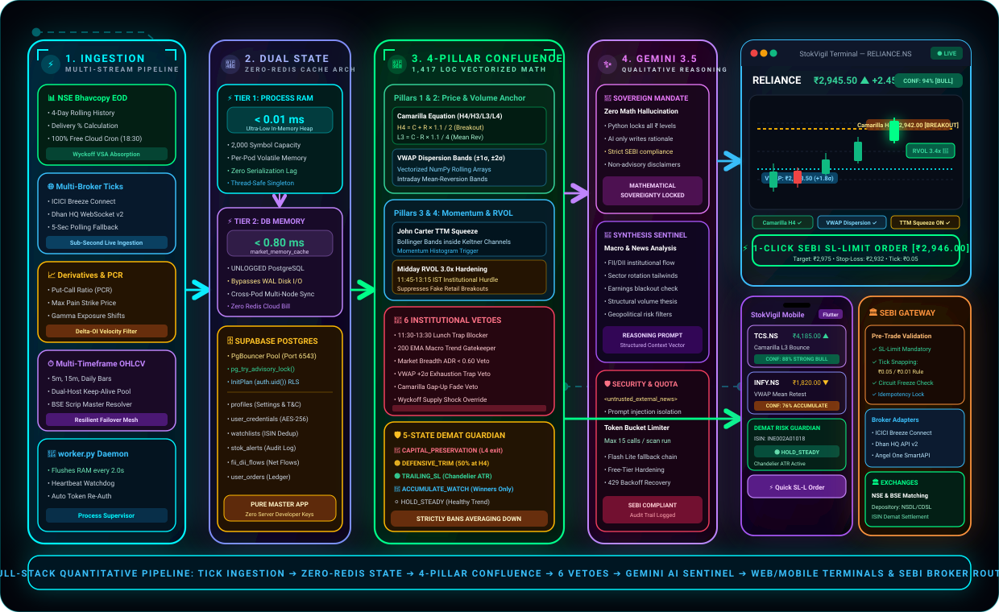
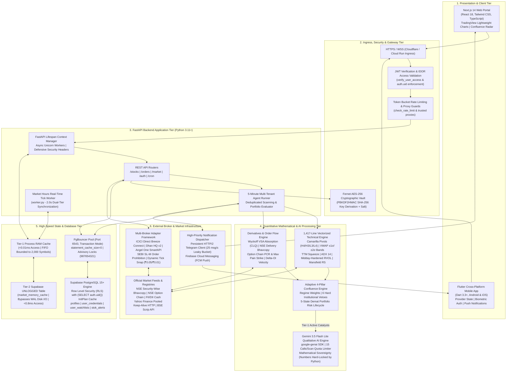

# STOKVIGIL AI: MASTER ARCHITECTURE & SPECIFICATION BLUEPRINT
**Document Classification:** Master Architecture Specification  
**System Identity:** StokVigil AI (`com.app.stokvigil`)  
**Domain:** Non-Advisory Institutional Quantitative Surveillance & Demat Risk Engine  
**Regulatory Compliance:** SEBI Research Analyst (RA) & Investment Adviser (IA) Non-Advisory Mandates  
**Target Markets:** National Stock Exchange of India (NSE) & Bombay Stock Exchange (BSE)  
**Supported Brokers:** ICICI Direct Breeze Connect, Dhan HQ Open API v2, Angel One SmartAPI  
**Specification Version:** 2026.11 (Production Grade)  

---

## 1. Executive Overview & Domain Philosophy

StokVigil AI is an institutional-grade, multi-tenant quantitative equity surveillance and automated Demat portfolio risk management system engineered for the Indian Financial Markets (NSE & BSE).

### Core Architectural Philosophy
1. **Factual Institutional Intelligence (Zero Advisory Overhead):** StokVigil AI never issues speculative "stock tips", guaranteed price targets, or subjective buy/sell recommendations. Every signal emitted is an audited mathematical calculation—anchored in verifiable order flow, Camarilla equation boundaries, Wyckoff volume spread analysis (VSA), options open interest (OI) dynamics, and delivery bhavcopy absorption. All targets and stop-losses are strictly designated as **Mathematical Volatility Benchmarks (1.5x / 2.5x ATR)**.
2. **Immutable Mathematical Sovereignty:** Large Language Models (LLMs) are strictly forbidden from calculating or generating numerical price levels, stop losses, position sizes, or quantitative scores. All numbers are deterministically generated by vectorized Python mathematical engines. The AI tier (Gemini 3.5 Flash Lite / 2.0 / 1.5) operates exclusively as a qualitative contextual synthesizer for active Tier-1 catalyst events.
3. **Pure Master App Publisher Model:** Retail users never register developer consoles, configure callback URLs, or manage cloud credentials. All master API secrets reside securely in backend environment variables. The user authenticates solely through daily session tokens / TOTP via their broker's official OAuth flow.
4. **Zero-Cost RAM-Speed Infrastructure:** By combining in-process Python memory caches with Supabase PostgreSQL `UNLOGGED` tables (bypassing Write-Ahead Logging / WAL), the system achieves sub-millisecond multi-container shared state without provisioning paid external Redis clusters.
5. **Capital Preservation First:** The engine treats risk management as asymmetric. A portfolio position is protected by a 5-state lifecycle (`CAPITAL_PRESERVATION_EXIT`, `DEFENSIVE_TRIM_ALERT`, `TRAILING_SL_ALERT`, `ACCUMULATE_WATCH`, and `HOLD_STEADY`), enforcing defensive trims and strict trailing stop ratchets.

---

## 2. Full-Stack Layered Topology

> [!TIP]
> **Interactive Architecture Visualizer**: Open [`stokvigil_architecture.html`](stokvigil_architecture.html) in your browser to interactively explore and toggle between the Full-Stack Market Engine and Multi-User Notification Architecture with live laser animations and device mockups.

### 2.1 Full-Stack End-to-End Market Engine

<p align="center">
  
</p>

### 2.2 Multi-User Notification Architecture

<p align="center">
  
</p>

### 2.3 Layered Topology Specification

<details open>
<summary><b>📐 Click to Expand/Collapse Mermaid Flowchart Topology</b></summary>


</details>

---

## 3. Database Schema, Security & Cryptographic Architecture

### 3.1 Cryptographic Storage (Fernet AES-256 Vault)
All sensitive credentials (`session_token`, broker app keys, webhook secrets) are encrypted at rest using AES-256-CBC via Python `cryptography.fernet.Fernet` with PBKDF2HMAC SHA-256 key derivation:
* **Per-Record Salt Header:** 16 random bytes prepended to each ciphertext payload.
* **Derivation Parameters:** `PBKDF2HMAC(algorithm=hashes.SHA256(), length=32, salt=salt, iterations=100_000)`.
* **Zero Plaintext Logs:** Handled via custom logging `SensitiveDataFilter` that automatically masks API keys, Telegram tokens, and UUIDs (`mask_id()`).

### 3.2 Row Level Security (RLS) with InitPlan Subquery Optimization
* **The Problem:** Bare scalar evaluation `auth.uid() = user_id` forces PostgreSQL to re-evaluate the auth context for every single row in the table, resulting in a severe $10\times$ performance penalty under high concurrency.
* **The Solution:** Every RLS policy in StokVigil AI uses `(SELECT auth.uid()) = user_id`. This forces PostgreSQL to evaluate `auth.uid()` once as an **InitPlan** per query and cache the result across the execution scan.

### 3.3 Least-Privilege Table Hardening (`user_credentials`)
* Raw access to `public.user_credentials` is completely revoked from public roles:
  ```sql
  REVOKE ALL ON public.user_credentials FROM anon, authenticated;
  ```
* Client applications verify broker connection status exclusively via the least-privilege view `public.user_credentials_status`:
  ```sql
  CREATE OR REPLACE VIEW public.user_credentials_status
  WITH (security_invoker = false) AS
  SELECT 
      user_id,
      broker_id,
      token_date,
      (token_date = (CURRENT_TIMESTAMP AT TIME ZONE 'Asia/Kolkata')::date) AS is_token_valid_today,
      created_at,
      updated_at
  FROM public.user_credentials
  WHERE user_id = (SELECT auth.uid());
  ```

### 3.4 Table Schemas & Column Specifications

#### `profiles`
| Column | Type | Constraints | Description |
| :--- | :--- | :--- | :--- |
| `id` | `UUID` | `PRIMARY KEY, REFERENCES auth.users(id) ON DELETE CASCADE` | Supabase User ID |
| `email` | `TEXT` | `NOT NULL` | User email address |
| `full_name` | `TEXT` | `NULLABLE` | Display name |
| `alert_sensitivity` | `TEXT` | `DEFAULT 'BALANCED'` | Options: `AGGRESSIVE`, `BALANCED`, `CONSERVATIVE` |
| `execution_mode` | `TEXT` | `DEFAULT 'PAPER_TRADING'`| Options: `PAPER_TRADING`, `SEMI_AUTOMATED`, `DISCRETIONARY` |
| `telegram_chat_id` | `TEXT` | `NULLABLE` | User's verified Telegram chat identifier |
| `telegram_enabled` | `BOOLEAN` | `DEFAULT FALSE` | Master Telegram alert toggle |
| `fcm_enabled` | `BOOLEAN` | `DEFAULT TRUE` | Master mobile push alert toggle |
| `tnc_accepted` | `TIMESTAMPTZ` | `NULLABLE` | Timestamp when SEBI risk disclosure was accepted |
| `role` | `TEXT` | `DEFAULT 'user'` | Options: `user`, `admin` |
| `is_admin` | `BOOLEAN` | `DEFAULT FALSE` | Administrative surveillance toggle |

#### `user_credentials`
| Column | Type | Constraints | Description |
| :--- | :--- | :--- | :--- |
| `id` | `UUID` | `PRIMARY KEY DEFAULT gen_random_uuid()` | Credential record UUID |
| `user_id` | `UUID` | `UNIQUE, REFERENCES auth.users(id) ON DELETE CASCADE` | Target user |
| `broker_id` | `TEXT` | `NOT NULL DEFAULT 'icici'` | Supported: `icici`, `dhan`, `angelone` |
| `encrypted_session_token`| `TEXT`| `NULLABLE` | Daily session token encrypted via AES-256 Fernet |
| `encrypted_app_key` | `TEXT` | `NULLABLE` | Client ID / API key encrypted via AES-256 Fernet |
| `token_date` | `DATE` | `NULLABLE` | Calendar date (IST) when the token was generated |
| `created_at` | `TIMESTAMPTZ`| `DEFAULT NOW()` | Record creation timestamp |
| `updated_at` | `TIMESTAMPTZ`| `DEFAULT NOW()` | Last update timestamp |

#### `user_watchlists`
| Column | Type | Constraints | Description |
| :--- | :--- | :--- | :--- |
| `id` | `UUID` | `PRIMARY KEY DEFAULT gen_random_uuid()` | Watchlist record UUID |
| `user_id` | `UUID` | `REFERENCES auth.users(id) ON DELETE CASCADE` | Owner user ID |
| `symbol` | `TEXT` | `NOT NULL` | Canonical ticker (e.g. `RELIANCE`, `500325.BO`) |
| `isin` | `VARCHAR(12)`| `NULLABLE` | Depository ISIN primary anchor (`INE...`) |
| `company_name` | `TEXT` | `NULLABLE` | Full company name |
| `average_buy_price` | `NUMERIC(12,2)`| `DEFAULT 0.00` | Demat cost basis for portfolio lifecycle management |
| `quantity` | `INTEGER` | `DEFAULT 0` | Demat shares held |
| `is_auto_synced` | `BOOLEAN` | `DEFAULT FALSE` | True if synced from broker Demat tradebook |
| `last_synced_at` | `TIMESTAMPTZ`| `NULLABLE` | Last sync timestamp |
| `created_at` | `TIMESTAMPTZ`| `DEFAULT NOW()` | Record creation timestamp |

#### `stok_alerts`
| Column | Type | Constraints | Description |
| :--- | :--- | :--- | :--- |
| `id` | `UUID` | `PRIMARY KEY DEFAULT gen_random_uuid()` | Alert record UUID |
| `user_id` | `UUID` | `NULLABLE, REFERENCES auth.users(id) ON DELETE SET NULL` | Target user (null for global broadcast) |
| `symbol` | `TEXT` | `NOT NULL` | Stock symbol |
| `alert_title` | `TEXT` | `NOT NULL` | Header title |
| `catalyst_type` | `catalyst_type_enum`| `NOT NULL` | Enum: `PRICE_BREAKOUT`, `VOLUME_SURGE`, `TECHNICAL_BREAKOUT`, `TRAILING_STOP_TRIGGER`, `CIRCUIT_LIMIT_EVENT`, `MACRO_CRASH_EVENT` |
| `impact_score` | `NUMERIC(4,2)`| `NOT NULL` | Confluence score (0.00 to 10.00) |
| `metrics_snapshot` | `JSONB` | `NOT NULL` | Immutable snapshot of indicators at alert emission |
| `created_at` | `TIMESTAMPTZ`| `DEFAULT NOW()` | Timestamp of emission |

#### `market_memory_cache` (UNLOGGED)
| Column | Type | Constraints | Description |
| :--- | :--- | :--- | :--- |
| `symbol` | `TEXT` | `PRIMARY KEY` | Normalized symbol |
| `payload` | `JSONB` | `NOT NULL` | Cached indicators, levels, and real-time tick data |
| `updated_at` | `TIMESTAMPTZ`| `DEFAULT NOW()` | Timestamp of last sync |

---

## 4. Dual-Tier Market Memory Cache Architecture

StokVigil AI eliminates the requirement for paid external Redis instances by combining in-process RAM with a PostgreSQL `UNLOGGED` table:

```
[ Incoming Tick / Indicator Calculation ]
                   |
                   v
+-------------------------------------------------------+
| Tier 1: In-Process RAM Cache (market_cache.py)        |  < 0.01 ms read/write latency
| - Thread-safe dictionary bounded to 2,000 symbols     |  Zero serialization overhead
| - FIFO eviction on boundary overflow                  |  Single-process hot memory
+-------------------------------------------------------+
                   |
                   | (Flushed every 2.0s during market hours 09:14-15:31 IST)
                   v
+-------------------------------------------------------+
| Tier 2: Supabase UNLOGGED Table (market_memory_cache) |  < 0.80 ms read/write latency
| - Bypasses Write-Ahead Logging (WAL) completely       |  Zero disk I/O amplification
| - Shared across all containerized Cloud Run instances |  100% free-tier resource utilization
+-------------------------------------------------------+
```

### Market-Aware Dynamic TTL
* **Active Market Hours (Mon–Fri 09:15–15:30 IST):** 20.0 seconds.
* **Off-Market Hours & Weekends:** 300.0 seconds (5 minutes).

---

## 5. Quantitative Technical Engine (Vectorized Mathematical Formulations)

All calculations in `technical_engine.py` (1,417 lines) are vectorized using NumPy and Pandas in 50-stock chunks.

### 5.1 Camarilla Pivot Equations (Prior-Day True Range)
Calculated using the completed prior-day (D-1) bar:
$$\text{Range} = \max(\text{High}_{D-1} - \text{Low}_{D-1}, |\text{High}_{D-1} - \text{Close}_{D-1}|, |\text{Low}_{D-1} - \text{Close}_{D-1}|)$$
$$H_4 = \text{Close}_{D-1} + \left(\text{Range} \times \frac{1.1}{2}\right) \quad (\text{Long Breakout Trigger})$$
$$H_3 = \text{Close}_{D-1} + \left(\text{Range} \times \frac{1.1}{4}\right) \quad (\text{Mean Reversion Short Boundary})$$
$$L_3 = \text{Close}_{D-1} - \left(\text{Range} \times \frac{1.1}{4}\right) \quad (\text{Mean Reversion Long Boundary})$$
$$L_4 = \text{Close}_{D-1} - \left(\text{Range} \times \frac{1.1}{2}\right) \quad (\text{Breakdown / Protective Stop Loss})$$

### 5.2 Volume-Weighted Average Price (VWAP) & Statistical Bands
$$\text{Typical Price } (TP_t) = \frac{\text{High}_t + \text{Low}_t + \text{Close}_t}{3}$$
$$\text{VWAP} = \frac{\sum (TP_t \times V_t)}{\sum V_t}$$
$$\sigma_{\text{VWAP}} = \sqrt{\frac{\sum V_t \times (TP_t - \text{VWAP})^2}{\sum V_t}}$$
$$\text{Upper Band 1} = \text{VWAP} + 1.0\sigma, \quad \text{Upper Band 2} = \text{VWAP} + 2.0\sigma \quad (\text{Exhaustion Zone})$$
$$\text{Lower Band 1} = \text{VWAP} - 1.0\sigma, \quad \text{Lower Band 2} = \text{VWAP} - 2.0\sigma \quad (\text{Value Zone})$$

### 5.3 John Carter's TTM Squeeze
* **Bollinger Bands:** 20-period SMA, 2.0 standard deviations.
* **Keltner Channels:** 20-period EMA, 1.5 ATR (14-period).
* **Condition:** $\text{Squeeze On} \iff \text{Upper BB} \le \text{Upper KC} \land \text{Lower BB} \ge \text{Lower KC}$.
* **Momentum Histogram:** Linear regression slope of $(TP - \text{Donchian Midline})$.

### 5.4 Time-of-Day Relative Volume (RVOL) with Midday Lull Hardening
RVOL evaluates current cumulative volume against historical distribution curves for the exact minute of the trading day. Between 11:45 and 13:15 IST (European open / Indian midday volume trough), the volume breakout hurdle is hardened to **3.0x RVOL** (compared to standard 1.5x) to eliminate false midday breakouts.

### 5.5 Other Indicators
* **Wilder's 14-period RSI:** Evaluated across 5m, 15m, and Daily intervals.
* **MACD (12, 26, 9):** Signal line cross and momentum divergence.
* **Wilder's ADX 14:** Directional trend confirmation ($ADX > 25$ trending; $ADX < 20$ rangebound).
* **Mansfield Relative Strength (MRS):** Normalized performance vs NIFTY 50 over a 52-week base.
* **15-Minute Opening Range Breakout (ORB):** High/Low boundary with wick rejection filters.
* **Circuit Freeze Lock Detection:** Identifies locked stocks ($\pm 1.90\%$ move with High == Low == LTP).
* **Wyckoff Volume Spread Analysis (VSA) Close Location Quotient (CLQ):**
  $$CLQ = \frac{\text{Close} - \text{Low}}{\text{High} - \text{Low}}$$
  * $CLQ \ge 0.70$ with heavy delivery indicates institutional absorption.
  * $CLQ \le 0.30$ with heavy delivery indicates institutional distribution.

---

## 6. Adaptive 4-Pillar Confluence Engine & Defensive Vetoes

The confluence engine calculates a weighted composite score (0.0 to 10.0) based on dynamic market regimes:

| Analytical Pillar | Standard Weight | High Volatility Defensive (VIX > 18) | Bull Momentum (Nifty > 20 EMA) |
| :--- | :---: | :---: | :---: |
| **Technical Momentum** | 35% | 25% | 40% |
| **Order Flow & Derivatives** | 30% | 40% | 25% |
| **Fundamentals & Forensics** | 15% | 20% | 15% |
| **Catalysts & Sentiment** | 20% | 15% | 20% |

### 6.1 The 6 Hard Institutional Vetoes (Zero Override Allowed)
1. **Lunch-Hour Trap Blocker (11:30–13:30 IST):** Prohibits breakout buys unless volume exceeds 3.0x RVOL.
2. **Market Breadth Veto:** Rejects all long setups if cash market Advance-Decline Ratio (ADR) $< 0.60$.
3. **Macro 200 EMA Trend Veto:** Vetoes long positions on stocks trading below their daily 200 EMA during weak market regimes.
4. **Anchored VWAP $+2\sigma$ Mean-Reversion Exhaustion Trap:** Vetoes late long entries when price exceeds $+2\sigma$ without base consolidation.
5. **Camarilla Gap-Up Fade Veto:** Vetoes opening gaps far above $H_4$ that fail to retest and hold the level.
6. **Wyckoff Supply Shock Override:** Immediately downgrades bias if delivery bhavcopy reveals heavy volume with $CLQ < 0.25$.

### 6.2 5-State Demat Portfolio Risk Lifecycle
* 🔴 **`CAPITAL_PRESERVATION_EXIT`:** Triggered when LTP breaks $L_4$ or drops $>8\%$ below average buy price.
* 🟡 **`DEFENSIVE_TRIM_ALERT`:** Recommends booking 50% profit at Target 1 ($H_4$) and moving stop-loss to cost basis.
* 🟢 **`TRAILING_SL_ALERT`:** Chandelier ATR trailing stop ratchets upward as profit expands.
* 🔵 **`ACCUMULATE_WATCH`:** Pyramiding permitted ONLY on winning positions displaying institutional delivery absorption.
* ⚪ **`HOLD_STEADY`:** Normal trend progression within tolerance bands.

---

## 7. Broker Adapter Architecture & SEBI Compliance

The broker subsystem implements an extensible Adapter Pattern:
```
                       +-----------------------+
                       | BrokerAdapter (base)  |
                       +-----------------------+
                                   |
         +-------------------------+-------------------------+
         |                                                   |
+-------------------+                               +-------------------+
| IciciDirectBroker |                               |   DhanHqBroker    |
| (Breeze Connect)  |                               | (Dhan Open API v2)|
+-------------------+                               +-------------------+
```

### 7.1 SEBI Regulatory Order Rules
1. **Strict Prohibition of Stop-Loss Market (SL-M) Orders:** All protective stop orders are converted to **Stop-Loss Limit (SL-L)** orders snapped to dynamic exchange ticks.
2. **Dynamic Exchange Tick Snapping:**
   * Price $\ge ₹250.00$: Snapped to ₹0.05 increments.
   * Price $< ₹250.00$: Snapped to ₹0.01 increments.
3. **Pre-Trade Circuit Freeze Rejections:** Halts BUY market orders during Upper Circuit and SELL market orders during Lower Circuit before broker API submission.
4. **Dynamic CNC vs MIS Detection:** If unheld shares are sold, the order routes as Margin Intraday Square-off (MIS) with an explicit SEBI warning regarding mandatory 03:15 PM IST square-off and potential 20% auction penalty risks.
5. **Financial-Grade Idempotency Debouncing:** Bounded in-memory idempotency cache (`_ORDER_IDEMPOTENCY_CACHE`) prevents duplicate order placement via `X-Idempotency-Key` or automatic hash fingerprinting (`auto:{user}:{sym}:{action}:{type}:{qty}:{price}`).

---

## 8. AI Reasoning Tier & Mathematical Sovereignty

StokVigil AI integrates Google's Gemini models (`gemini-3.5-flash-lite`, `gemini-2.0-flash`, `gemini-1.5-flash`) via the modern `google-genai` SDK with strict architectural boundaries:

```
[ Deterministic Quantitative Engine ]
                   |
                   | (Computes prices, levels, stop-losses, scores)
                   v
[ Mathematical Sovereignty Boundary ]
                   |
                   | Numbers are immutable. LLM cannot alter or create levels.
                   v
[ Gemini 3.5 Flash Lite Engine ]
                   |
                   | - Explains "WHY" the signal occurred.
                   | - Synthesizes catalysts, news RSS, and sector dynamics.
                   | - Encloses untrusted text in <untrusted_external_news>.
                   v
[ Final Audited Alert Dispatch ]
```

### Safety & Guardrail Features
* **Quota Limiting:** Maximum 15 AI calls per 5-minute multi-tenant scan cycle (`_MAX_AI_CALLS_PER_SCAN = 15`).
* **Prompt Injection Defense:** External news headlines and RSS items are strictly enclosed in `<untrusted_external_news>` XML blocks.
* **Tier-1 Catalyst Gatekeeper:** Gemini is only invoked for stocks with verified active catalysts (breakout $>H_4$, volume surge $>2.5\times$, circuit break, or institutional delivery spike). Quiet stocks use 100% deterministic templates.

---

## 9. Notification Delivery & Anti-Fatigue Subsystem

### 9.1 Telegram Rate-Limiting Architecture
* **Persistent HTTP/2 Session:** Eliminates TCP handshake overhead for high-concurrency alert bursts.
* **Leaky Bucket Rate Limiter:** Hard-capped at **25 messages per second** with exponential backoff on HTTP 429 status codes.
* **Rich HTML Payloads:** Custom formatted messages with action badges, Camarilla levels, Wyckoff absorption metrics, and SEBI compliance footers.

### 9.2 Anti-Fatigue Cooldown Manager
* **45-Minute Cooldown:** Alerts for the same stock-user pair are throttled for 45 minutes.
* **Instant Bypass Triggers:**
  1. An active Tier-1 catalyst occurs (e.g., $L_4$ stop-loss breach).
  2. The confluence bias flips (e.g., `BULLISH_BREAKOUT` &rarr; `STOP_LOSS_EXIT`).

---

## 10. Accuracy Verifier & Vectorized Strategy Backtester

### 10.1 Public Audited Accuracy Ledger (`/api/market/accuracy-ledger`)
Every emitted alert is written to `stok_alerts` with a complete JSON snapshot of its technical metrics at the time of creation. The `accuracy_verifier.py` engine independently evaluates subsequent OHLCV candles:
* **Target 1 Reached:** Candle High $\ge Target_1$ before Candle Low $\le Protective\_SL$.
* **Stop Loss Hit:** Candle Low $\le Protective\_SL$ before Target 1 reached.
* **Overnight Gap Slippage:** Models true execution prices by checking opening gap prices against stop-loss levels.
* **Realized R-Multiple:** Measures actual risk-to-reward ratio achieved.

### 10.2 Vectorized Strategy Backtester (`/api/market/backtest`)
* Runs multi-year historical backtests over NSE/BSE equities.
* Implements 1% capital risk position sizing formula:
  $$\text{Shares} = \left\lfloor \frac{\text{Account Capital} \times 0.01}{|\text{Entry Price} - \text{Stop Loss}|} \right\rfloor$$
* Calculates Win Rate %, Profit Factor, Max Drawdown %, and Sharpe Ratio.

---

## 11. Scheduled Pipelines & Automated Cron Timings (IST)

| Timing (IST) | Endpoint / Worker | Architectural Responsibility |
| :--- | :--- | :--- |
| **08:30 AM** | `POST /api/cron/morning-token-reminder` | Checks Demat broker tokens and prompts users with expired credentials to authenticate before market open. |
| **09:00 AM** | `POST /api/cron/pre-market-briefing` | Scrapes GIFT Nifty, Asian indices, FII/DII net flows, determines macro regime, and dispatches pre-market war room brief. |
| **09:14 AM – 03:31 PM** | `python -m app.worker` | Standalone background tick worker synchronizing live process RAM to Supabase `UNLOGGED` cache table every 2.0 seconds. |
| **09:15 AM – 03:30 PM** | `POST /api/cron/multi-user-scan` | Executes 5-minute automated scanning loop (Step 1 deduplicated RAM pre-computation $\to$ Step 2 user Demat portfolio evaluation). |
| **03:35 PM** | `POST /api/cron/post-market-summary` | Dispatches daily closing bell wrap, sector leaderboards, and accuracy scorecards. |
| **11:30 PM** | `maintenance.py` | Automated database pruning worker removing expired alert logs older than 30 days. |

---

## 12. Complete API Reference & Data Contracts

| Method | Endpoint | Auth Required | Description |
| :--- | :--- | :---: | :--- |
| `GET` | `/api/health` | None | Service health check and version status. |
| `GET` | `/api/stocks/search` | Rate Limited | Real-time security search supporting NSE/BSE symbols and company names. |
| `GET` | `/api/stocks/validate` | Rate Limited | Validates symbols against the universal depository ISIN Security Master. |
| `GET` | `/api/stocks/quotes` | Rate Limited | Batch multi-stock quote fetcher returning Camarilla levels and VWAP bands. |
| `GET` | `/api/stocks/{symbol}/analysis` | Rate Limited | Full multi-timeframe 4-pillar technical and flow breakdown for a specific stock. |
| `GET` | `/api/stocks/candles` | Rate Limited | OHLCV historical candlestick data for TradingView chart rendering. |
| `POST`| `/api/v1/orders/place` | Bearer JWT | Idempotent broker trade order execution with SEBI SL-M and circuit checks. |
| `GET` | `/api/user/profile` | Bearer JWT | User preferences, execution mode, and notification settings. |
| `POST`| `/api/auth/register-device` | Bearer JWT | Registers FCM push notification device token. |
| `GET` | `/api/brokers` | None | Lists supported broker integrations and connection modes. |
| `GET` | `/api/brokers/{broker_id}/login-url` | None | Generates official broker OAuth authorization URL. |
| `GET` | `/api/user/credentials` | Bearer JWT | Checks broker session token status via `user_credentials_status` view. |
| `POST`| `/api/user/credentials` | Bearer JWT | Encrypts and stores daily broker session token via Fernet AES-256 vault. |
| `POST`| `/api/user/delete-account` | Bearer JWT | Permanent account deletion complying with data privacy mandates. |
| `GET` | `/api/user/portfolio` | Bearer JWT | Fetches live Demat holdings, average buy price, P&L, and 5-state risk status. |
| `GET` | `/api/user/alerts` | Bearer JWT | Fetches historical alert log for the authenticated user. |
| `GET` | `/api/user/accuracy-stats` | Bearer JWT | Fetches verified performance statistics for user-specific alerts. |
| `GET` | `/api/market/backtest` | Bearer JWT | In-memory vectorized strategy backtester (Camarilla Breakout & Confluence Trend). |
| `POST`| `/api/market/backtest` | Bearer JWT | POST interface for custom backtest payloads. |
| `GET` | `/api/market/fii-dii-flows` | Rate Limited | Daily FII/DII cash turnover and institutional sentiment breakdown. |
| `GET` | `/api/market/accuracy-ledger` | Rate Limited | Public audited non-repudiation accuracy ledger. |
| `GET` | `/api/market/cache-stats` | Admin Header | Telemetry statistics for the dual-tier market memory cache. |
| `POST`| `/api/cron/multi-user-scan` | Cron Secret | Automated 5-minute multi-tenant market surveillance scan. |
| `POST`| `/api/cron/morning-token-reminder` | Cron Secret | 08:30 AM IST broker token expiration check and notification. |
| `POST`| `/api/cron/pre-market-briefing` | Cron Secret | 09:00 AM IST pre-market tactical brief broadcast. |
| `POST`| `/api/cron/post-market-summary` | Cron Secret | 03:35 PM IST post-market closing bell scorecard broadcast. |
| `POST`| `/api/telegram/webhook` | Webhook Secret | Handles interactive Telegram bot commands. |
